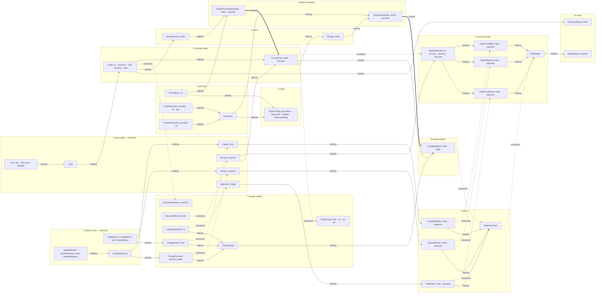
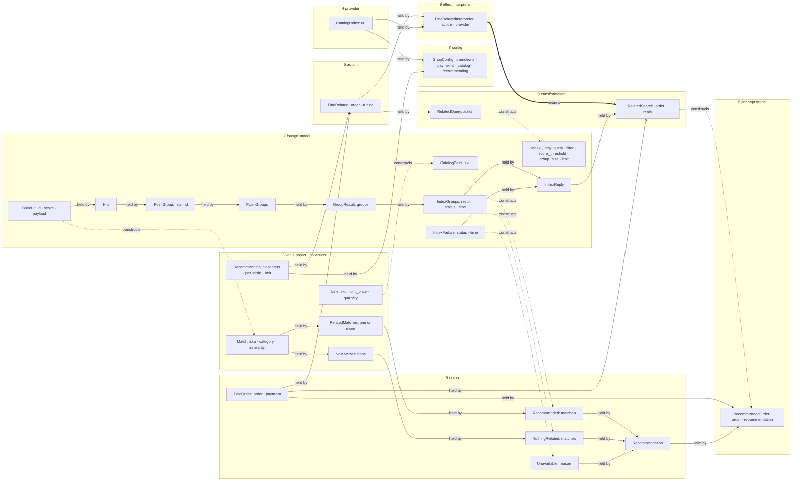

Every box is a class in the page its group names, and the group's number is its file's slot. An edge reads tail to head: `held by` is a field, `constructs` is `model_validate` by shared names, `returns` is an interpreter's `interpret`. What differs between the variants of a union is one derivation, under one name, on each variant.

## Checkout

## Recommend

