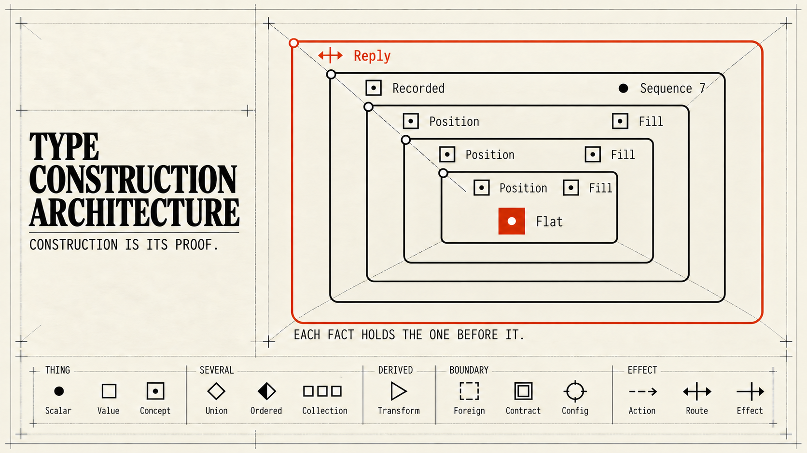

<h1 align="center">Type Construction Architecture</h1>

---

**Every layer of your service has something that checks it, except the one where your logic lives. TCA is an attempt to make that layer a set of types.**

> **Status: mid-refactor.** The first runtime ran a business program inside one request. It has been removed. Its replacement runs a program across events, time and failure, and it is not built yet. The idea below is unchanged. [What exists today](#where-it-stands) is small and stated plainly.

## The idea

You describe your business in Pydantic types: the values, the facts that follow from them, and the rules that must hold. A fact can only be constructed from the things that justify it, so the model says what the business is allowed to conclude. The framework's job is to carry that model out. It works out what can be built, asks the outside world for what is missing, and does only the work the declared outcome needs.

## Why a request is the wrong container

A real business process is rarely one request. A payment is captured hours after the order. An approval arrives tomorrow. The process restarts halfway. The usual answer is to write the business twice: once as types, and again as a workflow that sequences it. The workflow is where the bugs are, and nothing checks it.

TCA's target is that the declared types are the only account of the business. An invocation pursues an outcome and outlives any request, connection or process. While it waits for evidence it holds no open request. When the evidence arrives, it continues. After a crash it recovers without forgetting an external effect that already happened and without repeating it.

## What it should look like to build one

Take an order that ships only after a payment covers it. The developer declares the order, the payment as the provider reports it, the rule that the payment covers the total, and the outcome "shipped". They do not write the sequence. The rest of this README is what the framework is meant to guarantee for that one declaration. None of it is built yet.

- **The order is placed.** Nothing has paid, so the process waits. It holds no open request, connection or coroutine.
- **The process dies.** It restarts and resumes the same invocation, on the same version of the program, with the same history.
- **The payment callback arrives early.** It may land before the process has started waiting. It is kept, not lost.
- **The same callback arrives twice.** It becomes one piece of evidence and one unit of work. A second callback with the same delivery identity but a different payload is flagged, not accepted.
- **A callback arrives for a different order.** Matching field values is not enough. The source, tenant, order and version must match the declared relationship, or the callback is refused.
- **The carrier accepts the shipment, then the write that records it fails.** The outcome is uncertain, not failed. The carrier's declared recovery policy decides whether to retry under the same identity, look the shipment up, or hold it as uncertain with no automatic retry. The shipment is not requested again by accident.
- **A sibling step fails.** A shipment that already happened is not forgotten.
- **The caller disconnects or cancels.** What was already done stays done.

Each of these is a case in [`docs/REFACTOR_ACCEPTANCE.md`](docs/REFACTOR_ACCEPTANCE.md).

## What you declare, and what the framework owns

| You declare | The framework owns |
|---|---|
| The values and the rules that must hold over them | Constructing only what the declared outcome needs |
| The conclusions and the evidence each one needs | Admitting evidence and refusing what does not belong |
| Which sources you trust, and how their evidence correlates to an invocation | Waiting, resuming and recovering across restarts |
| The outcome you want | Deduplicating deliveries and giving each intended operation one identity |
| How each external call is retried or reconciled | Recording uncertain outcomes and rejecting stale workers |

The left column is the business. The right column is what teams otherwise rewrite for every workflow. TCA's bet is that the left column is enough to derive the right.

## Where it stands

- **Exists:** the value layer, in [`packages/python/type-construction-world`](packages/python/type-construction-world). Strict, frozen values, constrained scalars, records under a party's names, facts, computed values that cannot be forged, relations that refuse, and selections over finite tuples. Its tests pass. It cannot run a program, so nothing in the list above runs yet.
- **Exists, experimental:** the declared contract, in [`packages/python/type-construction-program`](packages/python/type-construction-program). How a program declares where external evidence comes from, an in-memory invocation history, and a pure evaluation that derives the next justified work from it. Its experiments exercise the four design questions of the architecture document without resolving them; what each experiment demonstrates, what it does not, and the counterexamples that overturned the first attempt are in [`docs/decisions/0002-demand-admission-and-occurrence.md`](docs/decisions/0002-demand-admission-and-occurrence.md), which supersedes [`0001`](docs/decisions/0001-durable-program-contract.md) in part. It has no durable host, so the list above still does not run.
- **Removed:** the request-based engine, command line, HTTP package and demo. They remain in Git history as reference only.
- **Not built:** evidence admission, invocations, waiting and recovery, external effects, and interfaces. The order is in [`TODO.md`](TODO.md).

The target architecture is [`docs/TCA_ARCHITECTURAL_FOUNDATIONS.md`](docs/TCA_ARCHITECTURAL_FOUNDATIONS.md). Its proposals are not verified. The behavior a replacement must show is in [`docs/REFACTOR_ACCEPTANCE.md`](docs/REFACTOR_ACCEPTANCE.md). Those are requirements, not tests that pass.

## What it will not do

- Constructing a type shows that the declared rules hold over the evidence admitted. It does not show that the evidence is true or that the business program is right.
- It does not make an arbitrary external call exactly-once. It gives each intended operation one identity. The operation itself must be idempotent or reconcilable.
- It is not a Python sandbox, a database, or a replacement for transactions where two invocations race for the same balance.
- It is not for a service that is mostly CRUD with few decisions.

## License

The packages and this repository are under the BSD 3-Clause License with the Commons Clause, in [LICENSE](LICENSE): use them, change them, and build on them in your own work, commercial or not, with attribution; what is withheld is selling them, or a product or service whose value is substantially theirs. The agents and skills under `.agents/` are under the Apache License 2.0, in [.agents/LICENSE](.agents/LICENSE), with no condition beyond its own.
