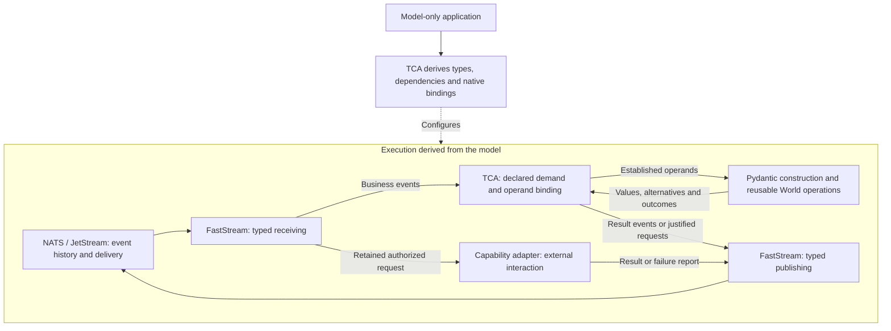

# TCA Architecture Design

## Overview

The industry has spent decades treating application logic as a bespoke, artisanal craft requiring endless imperative branching, even as declarative infrastructure demonstrated how much execution machinery can follow from an explicit model. Business applications can apply that same discipline.

Application code becomes tangled when business meaning lives implicitly inside procedures. Types describe payloads, while service methods separately encode what those values mean, which decisions follow, and when work should happen. Changing the business means finding and reconciling those scattered definitions.

TCA makes the business model the executable program. Developers declare values, constraints, unions, dependencies, sources, capabilities, and outcomes. Computations and decisions are compositions of reusable operations. Application authors write no procedural validators, transition functions, handlers, or workflows.

Three principles make this work:

- **Construction establishes guarantees.** Pydantic constructs values under declared constraints and typed alternatives. Consumers require the prerequisite values they actually need, rather than repeating business checks downstream. Source authority and execution permission remain explicit, separate relationships.
- **Intent activates dependencies.** An intent pursues a declared outcome. Explicit supplying relationships identify its operands; established values enable further constructions and justified capability work. Independent dependencies progress independently.
- **Events carry progression across time.** FastStream provides typed messaging integration. NATS/JetStream retains and delivers events, enforces channel permissions, and supplies native scheduling and consumer progress. New evidence advances the same declared program after waiting or interruption.

TCA derives the native bindings from the model and supplies only the dependency coordination those foundations leave necessary. Business meaning is authored once; execution follows from its explicit structure.

Developers author **types and relationships only**. Framework code supplies reusable operations and adapters; TCA derives their wiring. The event history supports continuation without preserving arbitrary Python instances.

**TCA is a model-only, type-driven, event-sourced application framework. The authored model is the entire business program.**

## 1. Application authors declare structure and relationships, never procedure.

The application authoring surface consists of:

| Declaration | Meaning |
|---|---|
| Pydantic models and constrained fields | Business values and their invariants |
| Literals and discriminated unions | Meaningful alternatives |
| Nested models and collections | Compositions and membership |
| Explicit supplying references | Which occurrence supplies an operand |
| Reusable operation compositions | Computations, comparisons, conditions, and selections |
| Source declarations | Where evidence may originate |
| Capability declarations | Requested work, prerequisites, reports, and recovery guarantees |
| Outcome declarations | What result is pursued and what constitutes completion |

Application-defined validators, computed-property bodies, serializers, default factories, callbacks, handlers, and workflow functions are outside this contract. Literal defaults are allowed. Framework configuration is derived; application configuration cannot silently change construction or serialization semantics.

## 2. World supplies the executable vocabulary.

World provides reusable typed values and operations: arithmetic, quantities, comparisons, Boolean composition, selection, projection, collection operations, and completion relationships.

An application expresses “add a surcharge” by composing a supplied addition operation with explicit operands and a typed result. Receiving or validating that result never performs the addition again.

New reusable operations are implemented through an extension interface with declared input types, output types, and deterministic behavior. Calling an implementation an extension does not permit an application workflow or hidden business rule inside a validator.

## 3. Pydantic constructs values; declared operations produce new values.

Pydantic checks the declared field structure, constraints, and union alternatives. Framework-provided value types may implement their invariants through native Pydantic mechanisms.

A computation consumes constructed operands and produces a separately identified typed result. Its calculation runs when that declared computation is evaluated, not when its result is decoded.

A decision produces an explicit alternative. Consumers require the appropriate alternative through their input types. A negative decision remains valid business evidence. Invalid input, missing evidence, and operational failure remain separate.

TCA adds no second business-validation or condition-evaluation language.

## 4. Every dependency has an identified supplier.

An occurrence is one realization within a pursuit. Its identity comes from its declaration location and, for collection members, its declared member key.

Two equal values, matching types, or matching business identifiers do not merge occurrences. Sharing is established by an explicit supplying reference or an unambiguous structural relationship. Ambiguity fails program binding.

References resolve to typed operands or declared projections of them. TCA does not inspect arbitrary Python bodies to discover dependencies.

## 5. Binding derives the runtime.

Program loading derives:

- Construction and computation dependencies.
- Typed receiving and publishing bindings.
- Occurrence addresses and subscription patterns.
- Source permissions and capability delivery bindings.
- Retention requirements and temporal notifications.
- Interface schemas and diagnostics.

Static inconsistencies fail loading. Subject-dependent addresses are completed when their declared identity values become available.

Developers do not maintain an operation registry, transport schema, handler inventory, or procedural workflow alongside the model.

## 6. FastStream is the application messaging integration.

Generated subscribers use the declared receiving types. FastStream performs native decoding, Pydantic integration, dependency injection, lifecycle management, and acknowledgement handling.

Generated publishers emit the declared message types. Native NATS client access supplies capabilities FastStream does not expose, within the same connection lifecycle.

Application authors write no receiving handlers. Framework handlers perform generic binding and coordination. Capability adapters implement the external interaction.

## 7. JetStream is the authoritative execution history.

Accepted intent, evidence, operation results, authorized requests, lifecycle decisions, and outcomes are retained as typed events.

NATS subjects address declared occurrences and interactions. Enforced permissions establish channel identity. Durable consumers supply delivery progress, distribution, acknowledgement, and redelivery.

Derived state is a view of retained events. It is not a second authoritative database. Recovery rebuilds the necessary view from retained records; it does not recreate arbitrary Python instances or rerun external effects.

No additional event-store service, router, scheduler, delivery tracker, or worker distributor is required.

## 8. Persistence uses declared data contracts.

Event payloads are explicit business data represented through Pydantic’s native JSON serialization and receiving validation, integrated through FastStream. JetStream retains and delivers those bytes.

A computation’s operands and result are distinct data contracts. Decoding a retained result constructs that result; it does not rerun its producer computation.

Framework-provided message and value types must support their declared serialization/receiving path. Their implementation owns compatibility with that path. TCA does not promise to persist arbitrary Python objects or arbitrary Pydantic customizations.

There is no pickle-based persistence, universal instance-restoration algorithm, round-trip gate, or application-authored codec requirement. Representation tests establish that supported contracts preserve their business fields and union alternatives.

## 9. Demand follows the declared outcome.

An accepted intent activates a declared outcome for identified subjects.

Required dependencies are pursued through their supplying relationships. Conditional dependencies are pursued only when their declared decision alternative activates them. Selection is expressed through the modeled alternatives and relationships, not a universal eager strategy.

Native requiredness, nullability, and defaults retain their Pydantic meanings. A default permits omission during construction; it does not authorize acquisition.

Optional acquisition requires an explicit stopping relationship when the application intends to wait. Available evidence is retained independently of whether it is currently demanded.

Changing demand stops newly justified acquisition on the abandoned path. Already initiated work and later observations remain accounted for.

## 10. Collection completion is modeled.

Each independently progressing member has its own occurrence identity. Equal-valued members remain distinct.

A result requiring completeness depends on the declared membership and completion evidence. Individual members can support independent work before that evidence establishes completeness.

TCA does not infer completion from silence, a timeout it invented, or the number of messages received.

## 11. Effects consume the request that was justified.

A capability declares its prerequisite/request type, report alternatives, source relationship, and provider recovery guarantees.

Execution requires both the constructed business prerequisites and the applicable demand, source, lifecycle, and execution authority. Constructibility alone grants no external permission.

The authorized request is retained before invocation. The adapter receives that request through its declared data contract. It may translate the request into the provider protocol, but may not introduce a second business decision or silently change the authorized business content.

Provider acceptance, business completion, and transport acknowledgement are different facts. Redelivery does not itself authorize repeating an external effect.

Idempotent, safely repeatable, reconcilable, and intervention-required capabilities retain their distinct recovery contracts. TCA promises no universal exactly-once external execution.

## 12. Concurrency protects justification.

Authorization and conclusion identify the exact evidence versions they consumed. New evidence does not rewrite historical justification.

All changes authoritative for a pursuit’s justification participate in its concurrency boundary. Native conditional publication and atomic publication protect that boundary. Checking only the destination message while supporting evidence changes is insufficient.

Native delivery remains discoverable across crashes. Acknowledgement follows the retained processing result. Retrying coordination must not create another authorization for the same established attempt.

These are framework execution mechanics, not application-authored procedures.

## 13. NATS owns runtime time.

Server-assigned recording timestamps anchor runtime-relative deadlines. Stream sequence establishes retained order within its stream scope.

Native scheduling delivers declared deadline notifications. Restart does not reset deadlines, and delayed delivery does not redefine their instants.

External timestamps are typed business claims. Evaluator wall clocks do not determine business progression.

## 14. Lifecycle and change remain explicit.

Source declarations specify replacement and dispute behavior. No undeclared latest-wins policy is assumed.

Outcomes declare completion and finality. Reopening requires a declared policy. Cancellation stops new authorization; its ordering against dispatch must preserve already initiated work and provider guarantees.

Retained work identifies the model and operation versions that established its meaning. A deployment cannot silently reinterpret incompatible work.

## 15. TCA implements only the missing coordination.

Its custom runtime derives bindings, tracks declared demand, supplies identified operands, invokes reusable operations, and records justified progression using native concurrency and delivery facilities.

Every proposed component must identify a concrete obligation these foundations leave unmet. Supporting forbidden application procedure is never such an obligation.

Development requires one application dev container and one persistent JetStream-enabled NATS container.

**Acceptance requires a model-only application to progress from intent through events, constructed prerequisites, external work, interruption, and outcome—with no application workflow code and no duplicated native subsystem.**
