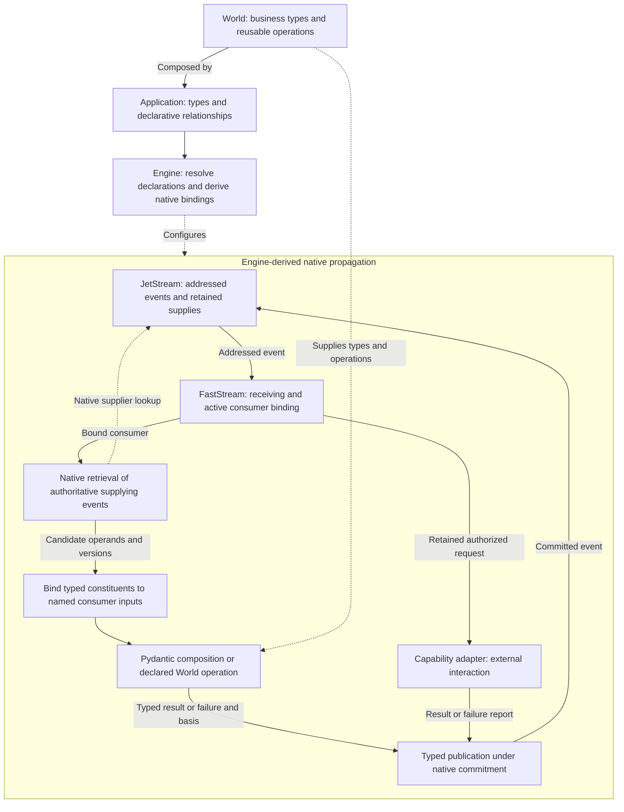

# TCA Architecture Design

**Owner:** Kyle Tobin  
**Status:** Approved architectural direction; concrete bindings require demonstrated integration.  
**Date:** October 30, 2026  
**Product:** [TCA Product Definition](../product.md)

## 1. Typed namespace and native execution

TCA binds declared business types and relationships into a typed, event-sourced NATS namespace. Engine is a construction propagator over that namespace: addressed events activate bound consumers, retained supplying occurrences provide their operands, and native constructions or reusable World operations produce conditionally published results.

World supplies business types and reusable operations. A business type, its declared occurrence, identity variables, supplying relationships, sources, and consumers together determine its native bindings. Reusing a Python class does not reuse an occurrence, address, source permission, or supplier.

Developers author the business model once. Engine derives its native runtime realization, not a separate business program. Type definitions, schemas, addresses, permissions, and runtime values are connected representations of those declarations; they are not interchangeable guarantees.

The computational model is typed, demand-driven incremental dataflow over retained events, with explicit effect boundaries. Declared dependencies determine propagation; retained events establish history; constructions produce derived values; version-consistent publication establishes new work. These are settled semantics. Native API and configuration choices realize them rather than determine them. They do not introduce another dataflow engine, projection service, or application workflow.

## 2. Model-only authoring and World semantics

Application developers declare business values and their execution relationships. Native Pydantic supplies the value algebra; World supplies reusable business values and operations; Engine interprets explicit occurrence and execution relationships. The same declaration is the source for construction, introspection, schema, and derived bindings. Applications do not maintain a second procedural program.

### Value algebra and construction

World supplies two minimal public model bases: a subclass of native `BaseModel` for products and a generic subclass of native `RootModel` for root values. Both set `ConfigDict(validate_default=True, frozen=True)`. Business models, including nested models, inherit from the appropriate World base. Binding rejects model or field overrides that disable required guarantees. These bases establish native configuration only; they add no replacement constructor, validation pipeline, serializer, or workflow behavior. Engine event contracts follow the same required construction policy.

The references to BaseModel and RootModel below denote these configured native subclasses.

| Form | Authoring representation | What supported construction establishes |
|---|---|---|
| Scalar or refinement | A named `RootModel[T]`, with native declarative constraints on its supported underlying value. | The resulting business value satisfies the declared scalar type and constraints. |
| Product | A named `BaseModel` with business-typed fields. | Required constituents exist together and satisfy their receiving annotations. |
| Sum | An explicit discriminated union of alternative models; a named `RootModel` makes the union a first-class business model. | Exactly the selected declared alternative is constructed with its required constituents. |
| Collection | A named `RootModel` over an explicitly typed native collection. | Members, cardinality, and structural ordering or uniqueness constraints follow the chosen native type and constraints. |
| Mapping | A named `RootModel` over explicitly typed keys and values. | The value is a genuine keyed relationship with the declared key and value contracts. |
| Finite vocabulary | `StrEnum` or literal values; alternatives with associated structure use a sum. | The value belongs to the declared vocabulary. |

These forms compose recursively. Named RootModels give identifiers, quantities, alternatives, collections, and mappings their own construction contract while preserving their native JSON root shape. Primitive annotations remain underlying material; independently meaningful business values receive names. A product's differently meaningful fields are not replaced by an untyped dictionary. A mapping remains appropriate for a genuine keyed relationship. Beyond the two configuration-only bases, TCA does not recreate native modeling forms as wrapper classes.

The supported declaration surface consists of these forms, concrete generic specializations, native `Annotated` constraints, `Field` declarations, explicit discriminators, literal data defaults, and declarative relationship metadata. Requiredness, nullability, constraints, aliases, and selected strictness are visible in the declaration. Native default validation applies through the shared bases; omission does not bypass a value's constraints. Pydantic owns its supported types, constraints, construction, and serialization behavior. The authoring specification defines TCA's allowed declarative surface and required configuration, not a separate contract for every native type/configuration combination. Arbitrary Python objects, `Any` as business meaning, and untyped containers are not substitutes for precise business modeling.

Successful construction establishes the resulting value's declared types, constraints, and alternatives. Consumers rely on those established guarantees rather than repeat them in downstream validation code. Construction does not establish undeclared cross-field rules, external truth, source authority, occurrence identity, currentness, or permission to act. Model those requirements through explicit types, operations, and execution relationships. Framework implementations use complete native construction; bypass construction, unchecked updates, and mutation are not means of establishing new authoritative values.

Established business values are immutable facts. A change constructs a new valid value; an authoritative update publishes a new establishment rather than editing the prior value. Native `frozen=True` blocks field reassignment but does not freeze mutable contents. Use native tuples or frozensets where their semantics fit, and frozen nested models; typed mappings remain supported and their established contents must not be mutated. Freezing alone is not a deep-immutability guarantee and does not require a custom recursive freezer. `model_copy(update=...)` does not validate its updates and cannot establish a changed business value.

At an external or durable receiving boundary, Pydantic constructs the declared value from the boundary's actual representation. After receiving, internal compositions and operations consume precisely typed business constituents directly. The framework uses native constructors or `model_validate` with supported Python/model inputs as appropriate; it does not flatten established constituents to JSON, translate them through generic mappers, or repeatedly revalidate them as a substitute for correct modeling. Constructing a new composition still establishes that composition's native guarantees. A consumer requiring a particular prerequisite receives that prerequisite type, not a generic record whose flags must be procedurally interpreted.

### Computation and extension boundary

World provides reusable typed values and operations for arithmetic, quantities, comparisons, Boolean composition, selection, projection, aggregation, collections, and completion. An application declares an operation application with explicit typed operands, supplying bindings, and a typed result. A result annotation alone does not specify its producer. The supported operation vocabulary and each operation's failure or alternative contract are explicit; developers compose those operations instead of supplying calculation bodies.

| Declared consumer | Execution |
|---|---|
| Business composition | Pydantic constructs the composition directly from its bound typed constituents. Assembly does not implicitly perform arithmetic or selection. |
| World computation or decision | Its reusable implementation consumes the declared typed operands and produces its separately declared result. |
| Retained result receiver | Native receiving construction establishes the result without rerunning its producer operation. |

Compositions and computations publish established results through the same native event infrastructure. Consumers require the appropriate constructed prerequisite or decision alternative. A valid non-holding alternative remains business evidence, not invalid input. Unavailable operands, invalid supplied content, consumer construction failures, and capability failure reports retain their boundary and evidence basis.

Pure derivations over declared operands are supported. Applications declare the derivation through reusable typed semantics; shared implementations select the appropriate native evaluation facility.

| Derivation behavior | Native implementation and meaning |
|---|---|
| Evaluate on access | A read-only property derives a view from existing business content on each access. |
| Evaluate on first access | A cached property stores a reusable result for that immutable value. The cache is not a new authoritative business fact. |
| Include a derived view in presentation | `computed_field` exposes a property in serialization and serialization schema. It does not imply construction-time computation or validate its result. |
| Establish a result during construction | A declared reusable operation constructs its typed result. A shared implementation may use a native default factory for a declared omitted-field derivation, respecting Pydantic's validated-field ordering and default-validation rules. |

Pure derivations depend only on their declared business operands, not ambient clocks, randomness, external reads, or side effects. Shared implementations establish the declared result type through native construction where required; a return annotation or `computed_field` decorator is not validation. Native property access and caching supply their normal behavior without a custom computation scheduler or cache-invalidation engine. A cached result is sound only while its business operands remain unchanged.

A derived view is distinct from an independently established result. If a value must supply retained evidence or a prerequisite, its declared producer establishes and commits that typed result with its basis. Property access, presentation, and serialization do not independently authorize effects or publish events. Section 4 separates presentation-derived fields from retained result fields.

Application-authored validators, arbitrary computed-property bodies, serializers, default-factory functions, custom constructors or schema hooks, callbacks, handlers, and workflow functions are forbidden. Relationships and computations cannot be hidden in such bodies. Native properties, cached properties, computed fields, and construction-time facilities may implement shared declared semantics; using them does not permit arbitrary application procedure. The binder reads explicit data declarations; it does not infer meaning by inspecting or executing application-authored function bodies. Native utilities such as `TypeAdapter` may implement a declared receiving boundary; their availability does not permit application procedures or a second value language.

World has no messaging or persistence dependency. Framework and extension authors implement reusable operations and external adapters through defined contracts. Framework value implementations own their native invariant mechanisms. Extensions add reusable semantics or integrations; they do not hide application workflows or business decisions in validation hooks. Engine-specific execution event types belong to Engine; reusable business values and operations belong to World. Shared reference primitives may be reused without introducing messaging dependencies into World.

### Authoring experience

The public contract presents World compositions and Engine-owned execution relationships coherently. Ordinary value definitions remain native Pydantic. Typed relationship descriptors attach through `Annotated` field metadata; relationships governing an occurrence attach to its declaration, not globally to every use of its Python class. Type references and declaration paths are data, not callbacks. Native annotations and `FieldInfo` expose receiving types and field semantics. Only meaning not unambiguously present in the structure requires additional metadata.

The authoring specification must give the actual Python declaration for each supported form and relationship, its inferred information, its required explicit information, and its binding diagnostics. Public descriptor names and signatures belong to that specification; they must implement the semantics here rather than invent another execution model. Developers do not duplicate field lists, schemas, dependency graphs, subject strings, subscriptions, or workflow steps. Framework configuration is derived from these declarations and declared deployment requirements.

Missing, conflicting, or ambiguous relationships fail binding with the declaration path, operand, and required correction in application vocabulary. Malformed runtime values retain native error locations plus their receiving occurrence and evidence basis. A developer changes a business rule in its declaration and can inspect the resulting execution without studying Engine internals.

## 3. Binding the graph to native facilities

A value type defines admissible content. A declaration location identifies its use in the program. An occurrence is a realization of that declaration within a pursuit, identified by its declaration location and, where applicable, its declared member key. The same Python type can have many declaration locations and occurrences. Any supported value shape, including a BaseModel product, can be independently supplied, retained, and versioned; naming a class or nesting a field alone does not create a separate addressed occurrence. A declared business-subject projection identifies the field or typed projection describing what it concerns. Projection paths must resolve during binding; values concerning several subjects declare the relevant roles. Equal values, matching types, names, or business identifiers do not merge occurrences. Sharing follows an explicit supplying reference or an unambiguous structural relationship; ambiguity fails binding.

Engine resolves references to typed operands or declared projections. Each resolved supplying binding identifies the consuming declaration and operand position, receiving annotation, supplying occurrence, projection if any, and supported native input/construction contract. Nested fields establish composition; supplying references establish dependencies across occurrences. Static inconsistencies fail loading. Declared identity variables complete subject-dependent addresses when their values become available. Resolved identity determines addressing; assigning a shared address cannot invent a supplying relationship. Business identifiers retain their domain value even when they contain NATS punctuation. Engine derives a deterministic, unambiguous subject-token representation that cannot inject separators or wildcards. An address-token restriction belongs to the addressing contract, not automatically to every World identifier.

The relationship vocabulary has the following declaration meanings. Every entry is explicit typed metadata unless the same meaning is unambiguously derived from native structure.

| Relationship | Required declared meaning |
|---|---|
| Identity and identity binding | Declaration location, member identity where applicable, and how identity variables bind to a supplier or consumer occurrence. |
| Supply | The supplying occurrence and any declared projection for a named typed operand. A matching type alone does not select a supplier. |
| Demand and acquisition | The pursued outcome, the alternatives that activate prerequisites, and which missing evidence justifies acquisition. |
| Authority | The source allowed to establish evidence and the capability permitted to perform declared external work. |
| Evidence selection | Eligible candidates, their occurrence scope, and latest, first, or a declared history-sensitive policy. |
| Membership and completion | Whether members are embedded or independently supplied, their identities, relevant ordering, and the evidence establishing a complete required set. |
| Business-subject projection | The field or typed projection identifying what an occurrence concerns, including distinct roles where needed. |
| Omission and stopping | Permitted absence or default, whether acquisition is requested, and the relationship that ends waiting. |
| Lifecycle | Cancellation, completion, finality, and any policy that permits reopening or later establishments. |
| Deadline | The recording event used as the runtime anchor, declared interval, and the meaning of the resulting notification. |
| Capability interface | Request/prerequisite type, success, refusal and operational-failure alternatives, source attribution, and provider recovery contract. |

A collection or mapping embedded in a value is constructed and retained with that value. Independently supplied members require a declared occurrence/membership relationship; only then does Engine derive member addresses. A mapping key does not automatically create an independently versioned occurrence. Native collection structure validates the supplied container; it does not prove that every required independently supplied member has arrived. Equal business identifiers neither merge occurrences nor replace declared membership.

| Declared meaning | Native realization and remaining responsibility |
|---|---|
| Occurrence identity | Derive an address or address pattern from the resolved occurrence and identity values. Preserve distinct occurrences and explicitly shared suppliers. |
| Supplying relationship | Native addressing selects the receiving relationship. Receive the retained supplying event into its declared type and bind the typed value or declared projection at the consumer's named operand position; no generic mapper or payload matcher rediscovers the relationship. |
| Decision alternative | Derive alternative-specific publication addresses from the constructed discriminator and resolved occurrence. Applications do not separately author another alternative identifier in the subject. |
| Source authority | Enforce publication permissions for the declared source channel and consume its established identity directly. Payload validity and external execution authority retain their separate contracts. |
| Demand | Intent and constructed alternatives activate the derived dependency and acquisition bindings. General evidence reception remains available independently; receipt alone does not activate acquisition. |
| Independently supplied membership | Derive keyed member addresses and native subscription patterns from the declared membership relationship. Equal-valued members under different identities remain distinct. Embedded containers do not acquire member subscriptions merely by having keys. |
| Collection completion | A World construction consumes declared membership and completion evidence. Members can support independent work before the complete collection is established. |
| Business events and progress | JetStream retains events; native consumers provide delivery, distribution, acknowledgement, and redelivery. Do not duplicate that progress bookkeeping. |
| Deadlines | Bind declared anchors to NATS recording timestamps and native scheduled notifications. |
| Commitment | Native latest-value retrieval supplies candidate operands. Conditional or atomic publication protects the authoritative changes relevant to the consumed basis; retrieval alone is not an evidence-consistent commitment. |

A discriminated union is a value shape. A decision occurrence adds its source and replacement/selection relationships; these do not follow merely from declaring a union. Alternative-specific events retain their decision occurrence and version. A consumer requiring a current alternative binds to the version selected by the declared replacement policy across that occurrence's candidate subjects, not merely the last message retained on one alternative's subject. Only events admitted under the declared receiving and source contract are candidates; unrelated descendants, refusals, and composite outputs are not automatically evidence for that decision.

Retrieval follows the policy at an identified stream snapshot:

| Declared policy | Required native retrieval |
|---|---|
| Latest by retained order | Retrieve the latest candidate on each matching subject at the snapshot and select the greatest stream sequence across them. |
| First by retained order | Retrieve the earliest matching candidate across the occurrence's subjects, bounded by the snapshot. Do not select the minimum from latest-per-subject results. |
| Dispute, business-field ordering, or another declared history-sensitive policy | Retrieve the candidate history required by that policy through the snapshot and apply its declared World operation. A latest-per-subject query cannot replace information the policy needs. |

For example, Approved@1, Declined@2, Approved@3 yields Approved@3 for latest and Approved@1 for first. Latest-per-subject returns Approved@3 and Declined@2; taking their minimum incorrectly yields Declined@2. After an approval is replaced by a decline under the declared policy, the old approval remains history but cannot silently satisfy a current approval prerequisite.

Native batched reads must consume their completion markers, handle required pagination, and preserve the same snapshot bound. A partial response or limit error does not establish absence or completeness. Historical lookup retrieves versions; retained typed references record which versions an actual construction consumed. Historical commitments preserve their original evidence basis without deleting history or adding a truth tracker.

Accepted intent activates the dependency and acquisition bindings for its declared outcome. Required dependencies follow their suppliers; constructed alternatives activate the declared branches. Native requiredness, nullability, and defaults retain their construction meanings. A default permits omission, not acquisition. Any acquisition that waits has an explicit stopping relationship. A nullable operand permits a constructed null value; it does not itself request acquisition or establish that waiting should stop. Deactivation stops new acquisition authorization while preserving initiated work and later observations. Queued delivery from an earlier activation does not independently authorize another effect.

An incomplete composition is represented by its declared dependencies and retained operands at their supplying addresses. Engine retains no half-constructed business object and no pending table duplicating availability. A subsequent relevant event triggers another attempt through the same binding. Reconstructible caches may accelerate reads but establish no separate readiness or arrival authority.

| Observed situation | Interpretation |
|---|---|
| No usable retained event supplies a required operand | The dependency remains unavailable; the consumer is not established. |
| A supplied payload fails its receiving type, including missing required payload fields | Invalid supplied information attributed to that receiving boundary. |
| Available operands fail their consumer composition | Consumer construction failure attributed to those operand versions. |
| A World decision produces a non-holding alternative | A valid business result that does not supply a prerequisite requiring the holding alternative. |
| A capability reports operational failure | An operation report, distinct from construction failure. |

Pydantic error names alone do not classify every missing-field case as waiting. Failure observations retain their boundary and basis without erasing independently established valid evidence.

Completion follows the declared relationship, not silence or an invented timeout. Message count establishes completion only when a declared membership rule makes that count meaningful.

Generated FastStream subscribers and publishers use the declared receiving and publishing types. FastStream supplies native parsing, Pydantic integration, dependency injection, lifecycle, and acknowledgement facilities. Receiving an external or retained event establishes its declared type. Engine then binds those typed constituents at named operand positions for native composition, preserving declared projections and native validation aliases. It must not assume serialization names always equal validation names. It does not dump and reload each constituent between internal constructions. Native NATS access supplements capabilities not exposed through FastStream within the same lifecycle. Bindings preserve intended fan-out and distributed-work semantics.

Business-key ingress bindings and any necessary native lookup derive from the declared business-subject projection and source relationship. An integration supplying only a business key can concern several occurrences and pursuits; preserve all declared receiving relationships. Resolve additional correlation through native addressing, retention, and lookup where needed. A shared key neither merges occurrences nor automatically requires a separate index or universal join mechanism.

These allocations do not prescribe one consumer per member, a universal selection strategy, or one stream per pursuit. Stream configuration must satisfy the native commitment boundary in section 5; a subject prefix alone is not evidence that it covers the resolved dependency graph.

## 4. Event data contract

Accepted intent or activation, evidence, operation results, authorizations, refusals, cancellations, lifecycle decisions, and conclusions are retained as public typed events. Engine-emitted authoritative facts use Pydantic event contracts and the same native construction and serialization discipline as business events. Facts needed for continuation and other readers are retained; temporary local variables do not require events. Diagnostics derive from declarations and retained facts, not inaccessible authoritative runtime structures. JetStream is the execution history; reconstructible views and caches establish no competing authority.

Persisted and external messages use Pydantic's native JSON serialization and receiving construction through FastStream or the declared native boundary. JetStream retains and delivers the published bytes. Reading an event is a durable boundary even when its producer belongs to the same application. Once received, its typed business value participates directly in internal composition. Direct-call boundaries can use native Python/model inputs; JSON is not the universal internal representation. Integration checks establish that TCA's chosen receiving/publishing configuration preserves business fields and alternatives; TCA does not implement another codec or an exhaustive compatibility matrix for Pydantic.

Operation inputs and produced results have distinct contracts. Authoritative event fields are ordinary declared data fields, including any established operation result. Derived presentation fields use native exclusion from authoritative event dumps (`exclude_computed_fields=True`); presentation serialization may include them. They do not become stored result fields merely because `computed_field` includes them in a normal dump. Decoding a retained result constructs that result; it does not rerun its producer calculation or substitute a recomputed presentation value. A new interpretation requires the declared establishment/version policy, not a serializer side effect. A published, addressed composite retains its business content, occurrence identity, typed supplying-event references, and model/operation identities. Pure assembly does not exempt an established result from retention. Its basis explains establishment, not universal reconstruction from ancestry. Transient implementation objects do not require separate events.

A declared construction may produce updated versions as its supplying evidence changes; it need not represent a terminal outcome. Each version is a newly constructed value, not mutation of an established instance. Each result remains derived from its recorded operand basis, with JetStream retaining authoritative history. Producing an updated value does not itself authorize capability execution; effects remain governed by declared demand, prerequisites, lifecycle, and provider contracts.

Declared supply and retained justification are one relationship before and after execution: the declaration identifies the supplying occurrence; the retained justification binds that edge to the event actually consumed.

| Typed justification payload field | Meaning |
|---|---|
| Consuming operand or declared edge | The dependency through which the value was used. |
| Supplying occurrence | The resolved occurrence that supplied it. |
| Stream identity and event sequence | The actual retained version consumed. |
| Declared projection, when applicable | The field or projection consumed from that event. |

Headers may carry routing or convenience metadata, but are not the sole authoritative representation of justification. Execution lineage is the version-bound realization of declared dependencies, not a separately authored lineage graph.

For Engine-generated alternatives, derive address agreement from the constructed discriminator. For external ingress, native receiving construction establishes the declared relationship between addressed context and payload content; enforced publication permission independently establishes the source channel.

Persistence concerns declared business data, not arbitrary Python instances or application procedures. No pickling subsystem, universal instance-restoration algorithm, or application-authored codec is required.

Direct-call, CLI, HTTP, and event interfaces reuse the same business declarations. Representation differences introduce no competing business rules. Applications may integrate external business-data stores; those stores retain their own constraints, permissions, and transactions.

## 5. Commitment and continuation

A capability declares its prerequisite/request type, typed success, legitimate refusal and operational-failure reports, source relationship, and actual provider recovery guarantees. Adapter code implements external interaction; the model establishes the work and the reports it can mean. Constructed business prerequisites, declared demand, bound provenance, lifecycle, and provider authority justify work together. Constructibility alone grants no external permission.

Retain the authorized request before invocation. The adapter receives that request through its declared data contract and translates it into the provider protocol without silently changing its business content or adding another business decision.

Authorization and conclusion identify the actual supplying versions consumed and any relevant omission or completion basis. Only versions permitted by the declared currentness and replacement relationships satisfy a current dependency. A subtree is a sufficient commitment scope only if it covers those resolved suppliers, relevant authority and lifecycle changes, future arrivals that would change omission or membership, and the publication destination. Nesting alone does not establish this coverage.

Use optimistic validation of a versioned read basis:

1. Resolve a covering subject filter `F` within one JetStream stream. Include the destination so successful publication advances the checked scope. Widen to a common ancestor when a supplying reference or authority relationship lies outside the immediate subtree; use stream-wide validation when necessary.
2. Capture a stream sequence boundary `S` before reading operands. Retrieve policy-selected evidence, relevant authority, and the latest matching scope sequence `W` as of that same `S`. Complete all reads at that bound. Do not read old operands and then obtain a newer watermark that can hide an intervening change.
3. Construct from that basis. Publish with `Nats-Expected-Last-Subject-Sequence: W` and `Nats-Expected-Last-Subject-Sequence-Subject: F`. For a stream-wide check, use `Nats-Expected-Last-Sequence: S`.
4. A conflict discards the proposed publication, refreshes the relevant basis, and reconsiders the work. A prior publication under the same established basis and attempt is recognized from retained typed records, not another deduplication ledger. Publish related records atomically where their contract requires all-or-nothing establishment.

All authoritative versions validated by that commitment must be represented in its native stream scope. Evidence originating elsewhere requires an explicit retained admission relationship into that scope; this does not create an atomic transaction with the upstream system. An enlarged scope permits false conflicts from unrelated writes, not stale authorization. A shared stream's last sequence protects the shared stream, not automatically one pursuit.

The read path must establish that the snapshot is available and sufficiently current for its trigger before acknowledging an unavailable dependency. Direct Get must not be assumed read-after-write coherent across replicas; use a demonstrated freshness guarantee or leader-routed native retrieval. Expiry, purge, deletion, or incomplete retention must not remove facts needed to establish a basis or conceal a relevant authority change. No transaction is implied across arbitrary streams or external resources.

Acknowledgement follows the retained processing result. Native consumers keep work discoverable across interruption. Repeated coordination does not create another authorization for the same established attempt. Delivery, provider acceptance, business completion, and transport acknowledgement remain different facts.

Native redelivery does not grant permission to repeat an external effect. Capability contracts govern idempotent, safely repeatable, reconcilable, and intervention-required execution. Immediate and delayed reports satisfy the same declared business relationship. A report may establish content while its attribution to an attempt remains unresolved.

Source declarations determine replacement and dispute behavior; there is no undeclared latest-wins policy. New evidence changes current knowledge without rewriting historical justification. Lifecycle is declared for pursued outcomes and their constructions, not only for capability calls. Outcomes declare completion and finality; reopening requires declared policy. Cancellation stops new authorization, with dispatch ordering preserving initiated work and provider guarantees. Intervention supplies authoritative evidence, not an invented repeat-safety guarantee.

NATS owns runtime time. Server recording timestamps anchor runtime-relative deadlines; stream sequence establishes retained order within its stream scope. Native schedules deliver declared deadline notifications. Restart does not reset deadlines, and late delivery does not redefine them. External timestamps remain typed business claims; evaluator wall clocks do not determine progression.

Retained work identifies its model and executable meaning through derived identities. Required model configuration and shared derivation semantics participate in those identities; a cached property's temporary storage does not. Model identity covers canonicalized declarations, schemas, resolved relationships, and operation contracts. Executable identity additionally covers operation implementations and dependency artifacts that affect behavior. A manually maintained application version is a release label, not the authoritative identity of executable meaning.

Schema equality alone does not establish executable equivalence. A changed fingerprint detects change; it does not by itself establish incompatibility or provide a migration. Compatibility must preserve retained contracts and established meaning. New deployments cannot silently rerun or reinterpret retained work under different semantics.

Continuation uses retained events and native consumers without a live request or coroutine, arbitrary object restoration, or automatic replay of external effects.

## 6. Engine implementation boundary

Engine implements one generic propagation mechanism through the following responsibilities:

1. Resolve native value declarations and typed relationship metadata into occurrence-specific bindings. Enforce the configured-base policy, including nested models and required model/field settings. Reject ambiguous or unsupported declarations without executing application bodies.
2. Activate those bindings from declared intent, alternatives, and lifecycle.
3. Retrieve and natively receive authoritative supplying events, then bind their typed values or declared projections as consumer inputs.
4. Perform native composition or invoke the declared reusable World operation. Use shared native derivation facilities according to section 2; property access does not create another propagation mechanism.
5. Publish the typed result, failure observation, or justified request with its basis under the native commitment contract.
6. Apply capability and lifecycle contracts where delivery alone cannot establish the required fact.

An addressed event identifies affected consumers through its resolved binding. For each active consumer, the propagator retrieves candidate operands, applies the boundary distinctions in section 3, constructs or computes, and commits under section 5. Conflicts refresh the relevant basis. Native acknowledgement and redelivery remain processing mechanisms, not permission to repeat an effect.

Engine consumes business guarantees from World and enforced bindings. This is one generic propagator, not separate pending-state, demand, delivery-progress, business-rule, or lineage subsystems. Additional retained records or coordination require a specific unmet obligation; a semantic distinction alone does not prescribe a subsystem.

No separate business-validation language, router, trust engine, event-store service, scheduler, deadline scanner, delivery-progress tracker, redelivery engine, or worker distributor belongs in Engine. No generic model-conversion pipeline, recursive freezing subsystem, computed-property scheduler, or replacement Pydantic compatibility layer is introduced by the authoring contract.

Development uses one application dev container and one JetStream-enabled NATS container with persistent storage. This is a single-node development topology, not a high-availability claim.

## 7. Design evidence and acceptance

For every consequential relationship, demonstrate:

**Declaration → resolved occurrence and subject projection → address/permission → active receiving binding → native operand retrieval → input assembly → construction or operation → typed result and justification → conditional publication → downstream delivery.**

Name the actual declaration, native mechanism, and guarantee at each step, including the operand versions, construction or operation, publication condition, and retained result. For each remaining Engine operation, identify the exact fact the native composition leaves unestablished. Use the same authoring contract and bindings across the public specification, native mapping, and behavioral histories. Each supported value form, relationship descriptor, and operation application has a contract row identifying its actual Python authoring form, construction guarantee, derived binding, native facility, and executed acceptance history. These rows specify TCA's authoring and execution semantics and actual integration boundaries; they do not enumerate every combination of native Pydantic features. Developers do not maintain a second declaration inventory in their applications.

Acceptance requires a model-only application progressing from intent through events, constructed prerequisites, external work, interruption, and outcome. Demonstrate the histories below, pairing prevented errors with legitimate progress:

- An incomplete composition becomes constructible without a pending table; absent evidence remains distinguishable from malformed supplied content.
- Valid negative alternatives and replacement across alternative-specific subjects preserve the authoritative current version and historical justification. Approved@1, Declined@2, Approved@3 must select @3 under latest and @1 under first; history-sensitive dispute cases retain all evidence their policy requires.
- Configured World root and product bases apply native default validation and freezing, including nested models. Invalid defaults fail native construction and required configuration cannot be disabled through model or field overrides.
- Named root scalars, sums, collections and mappings compose directly as typed constituents within products. Persisted and external boundaries use native receiving and publishing; no internal JSON round trip or generic conversion pipeline is needed. Focused checks cover TCA's use of constraints, defaults, aliases, nullability, and declared strictness without assuming Python-mode and JSON-mode behavior are identical.
- Field reassignment cannot change established values; framework paths do not mutate nested business content or use unchecked copy updates to establish replacements. A changed value is newly constructed and a retained update preserves the earlier establishment.
- Shared suppliers, repeated uses of one model class, independently addressed products, distinct collection members, completion-dependent results, and independent consumers retain their declared identities and progress. Embedded mappings remain embedded; independently supplied membership progresses under its explicit relationship.
- Declared operation applications compute from named typed operands; receiving their retained results does not repeat computation. Exercise on-access, cached, and construction-time derivations where declared. Derived views leave business operands unchanged, cache population creates no business event, and authoritative dumps exclude computed presentation fields while retaining established result fields. An application expresses calculations and branches without arbitrary validator, property, or callback bodies.
- Business-key correlation reaches multiple legitimately related occurrences and pursuits without merging them.
- Concurrent operand changes cause basis refresh and reconsideration rather than stale commitment. Include a supplier outside the immediate subtree, an operand change before a later watermark read, an absent operand arriving during construction, competing publications, and an unrelated write outside the protected filter.
- Restart after publication but before acknowledgement preserves established work without duplicate authorization.
- Public typed Engine events support continuation and developer-visible explanations.
- Derived identities detect changes in declarations and executable behavior, while compatibility is assessed against retained meaning.
- Capability delivery and provider-governed recovery preserve authorized content without unjustified repetition.
- Conditional demand, early and delayed evidence, NATS deadlines, cancellation, and finality follow the same bindings.

Show a business-rule change made once and diagnostics explaining established facts, attempted work, blocked dependencies, and legitimate next progress in application vocabulary. Include binding errors for ambiguous suppliers and inadmissible procedural declarations, business identifiers containing transport punctuation, and the distinction between omission, null, acquisition, and stopping. Cancellation, finality, reopening, and recording-time deadlines must work for ordinary constructions as well as capabilities.

Use focused checks against selected native versions. Verify TCA's required configuration, operand bindings, evaluation semantics, and actual boundary integration; rely on Pydantic's native implementation rather than rebuilding its type-system test suite. Distinguish executed integration, isolated experiments, derived behavior, and unresolved claims. Verify actual client signatures or use the documented native request protocol; compilation is not API or integration verification. Source inspection supports native capability claims but does not establish the composed histories. Subject grammar, stream/consumer configuration, snapshot retrieval, and commitment scope require concrete demonstration. Artifact presence, schema hashes, native feature names, and diagnostic output do not substitute for the composed guarantee.

The reported single-node integration used nats-server 2.15.2 with JetStream file storage and nats-py 2.16.0 and passed 20 checks of policy selection, snapshot commitment, conflicts, and unavailable operands. This is reported evidence, not an independently inspected repository acceptance suite. It does not establish replica freshness, pagination beyond one batch, or atomic batch publication. The durable integration demonstration must exercise those branches where required and identify the exact code, configuration, versions, and results; temporary probes do not become production Engine components.

Complete the artifacts in dependency order: the World/shared authoring contract defines the supported declarations and developer experience; the Engine realization specification binds their exact semantics to native facilities; the integrated execution demonstration executes that same contract. The artifacts must agree without requiring application-specific execution code or duplicating native capabilities.

The reference read mechanisms are documented in [NATS ADR-31](https://github.com/nats-io/nats-architecture-and-design/blob/main/adr/ADR-31.md); native publication conditions are documented in [JetStream publication headers](https://github.com/nats-io/nats.docs/blob/master/nats-concepts/jetstream/headers.md). These establish available primitives; execution evidence must separately identify the composed protocol it exercised.

The native value contracts follow [Pydantic models and RootModel](https://docs.pydantic.dev/latest/concepts/models/), [fields and metadata](https://docs.pydantic.dev/latest/concepts/fields/), and [serialization](https://docs.pydantic.dev/latest/concepts/serialization/). These document the underlying facilities; TCA's supported declaration inventory specifies their application role.

The governing acceptance rule is a complete model-only business program, faithfully realized through native facilities, with no application workflow code and no duplicated native subsystem.
