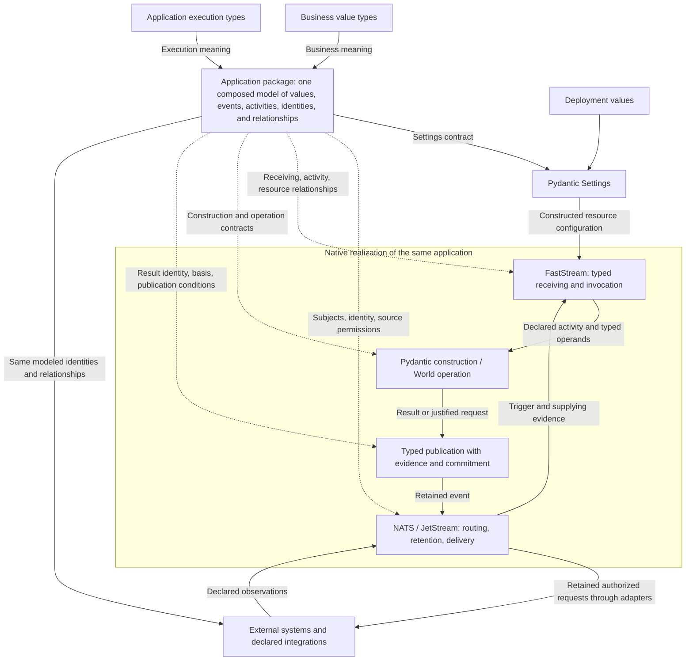

# TCA Architecture

**Owner:** Kyle Tobin  
**Status:** Architectural contract; public authoring specifications and native integrations must demonstrate the guarantees stated here. This document does not claim completed implementation.  
**Date:** October 31, 2026  
**Product:** [TCA Product Definition](../product.md)

**A TCA application is one composed model of business meaning and event-driven activity whose names, identities, and relationships determine its native execution topology, so running the application requires realizing that model through Pydantic, FastStream, and NATS rather than authoring a second program.**

## 1. Purpose and quality goals

TCA enables developers to deliver complete event-driven applications through precise typed declarations. Developers model their business and the run of their application inside a separate Python package that imports TCA.

Framework authors define specialized execution models using the same typed composition as business models. Their native bindings implement those declared semantics. World and run identify modeling responsibilities within one framework; they do not prescribe separate packages or independently authored programs.

The design minimizes independently maintained descriptions of application meaning. A relationship is declared once; its receiving bindings, subjects, permissions, and downstream projections follow from that declaration. Changing it requires no second wiring edit.

The quality goals are correct construction and commitment, consistent model composition, changes localized to their authoritative declarations, durable continuation, and explainable execution. Custom procedure is limited to obligations that native facilities do not fulfill.

## 2. Architectural constraints

- Events drive transformational application activity. The model determines what each event establishes, which activity it activates, and what that activity may establish next.
- Developers and framework authors use typed modeling to express business and execution meaning. Run constructs specialize the common modeling discipline; they do not introduce handlers, registration scripts, or another authoring language.
- The composed model is the authority for topology. Derived configurations and bindings are not separately maintained application definitions.
- Pydantic owns native value construction. FastStream and NATS supply the native execution mechanisms. TCA procedure fulfills only obligations left by their composition.
- Application-authored validators, arbitrary computed-property bodies, serializers, default factories, custom constructors or schema hooks, callbacks, handlers, and workflow functions are forbidden. Reusable framework operations and integration adapters have explicit typed contracts.
- An allowed declaration cannot be rejected merely because an implementation recognizes a narrower syntax. Native Pydantic acceptance alone does not authorize forms outside TCA's contract.

## 3. Package structure and application boundary

TCA is one installable distribution, `type-construction`, with import namespace `type_construction`. The framework does not have separately versioned World and program distributions. Module boundaries follow dependencies and responsibilities; independent distributions require an actual independent-use or release requirement.

The package layout is:

| Path | Responsibility |
|---|---|
| `packages/python/type-construction/pyproject.toml` | Framework distribution metadata and dependencies. |
| `src/type_construction/__init__.py` within that package | Public exports, including `Model` and `Root`; no startup or orchestration side effects. |
| `src/type_construction/models.py` | The two configuration-only model bases. |
| `src/type_construction/py.typed` | Typing marker. |
| `tests/` | Tests of framework-specific contracts and native integration. |

Execution-model and integration modules are added when their concrete contracts require them. No empty `engine`, `core`, or plugin subsystem is required by this layout.

A developer's application is a separate installable Python package that depends on `type-construction`. It imports the framework's public types, owns its domain declarations, and composes its application model. TCA defines how the package exposes a runnable declaration. This layout specifies the required package structure; repository migration is separate implementation work.

| Participant | Responsibility |
|---|---|
| Application developer | Accurate domain models, event/activity relationships, evidence requirements, outcomes, configuration schemas, and selected integrations. |
| Framework author | Reusable World and run types, coherent composition rules, and minimal native realization. |
| Deployment operator | Environment values, credentials, infrastructure, and granted native permissions. |
| External system | Its own authoritative data, transactions, permissions, and effect guarantees. |

Interfaces admit typed events and expose declared results. HTTP, CLI, direct calls, and message delivery do not create separate business rules or a second procedural execution path. Pure value construction remains available without starting an application.

Business value definitions remain independent of settings loading, messaging, and persistence even though they share the framework distribution with execution models and native integration.

## 4. Solution strategy: composition determines execution

A value type describes what may occupy a position. Its placement in the application gives that position a role. A modeled event relationship connects an admitted occurrence to an activity; modeled supply identifies its operands; the activity declares the construction or operation and result. The result's establishment produces an event that can participate in further declared relationships.

Those connections are the application topology. Native bindings are derived from these connections; applications and integrations do not maintain another dependency graph.

An event may supply an activity's entire input directly. An activity needing independently retained evidence declares those supplying relationships and selection policies. Matching Python types do not choose suppliers, and direct typed composition does not require an invented reference lookup.

Pydantic constructs values, FastStream invokes the declared receiving and publishing bindings, and NATS routes and retains their events. Native facilities do not invent application meaning: the run models determine activation, supply, identity, authority, and result semantics.

Every native binding identifies its source declaration, the native guarantee it uses, and any remaining framework obligation. Integration code derives native configuration and invocation from the relationship; it must not restate that relationship in a separately authored procedure.

Application integrations project the relevant modeled identities and relationships into external systems. Additional required meaning must be declared. Extending an application with a provider capability is distinct from replacing the framework's execution foundation; section 5.5 defines that boundary.

## 5. Modeling contracts and building blocks

### 5.1 Value foundations and World modeling

`type_construction.Model` subclasses native `BaseModel`; `type_construction.Root[T]` subclasses native `RootModel[T]`. Both are defined in `models.py` and set `ConfigDict(validate_default=True, frozen=True)`. Retain these configuration-only bases without adding constructors, validators, traversal, serialization, or runtime behavior.

Business models, nested models, and framework-owned retained value contracts preserve those guarantees. The bases establish inherited native configuration; they do not prevent Python overrides or enforce the entire allowed authoring surface. Application acceptance must reject model or field settings that disable required guarantees and declarations containing forbidden application procedure.

| Form | Representation | Meaning established by construction |
|---|---|---|
| Scalar or refinement | Named configured `RootModel[T]` with native constraints | A business value satisfies its underlying type and constraints. |
| Product | Named configured `BaseModel` with business-typed fields | Required constituents exist together and satisfy their receiving annotations. |
| Sum | Explicit discriminated union of alternative models; optionally a named root | One declared alternative is constructed with its constituents. |
| Collection | Named root over a typed native collection | Members and structural constraints follow the declared native type. |
| Mapping | Named root over typed keys and values | A genuine keyed relationship satisfies its key and value contracts. |
| Finite vocabulary | `StrEnum` or literal values | A value belongs to the declared vocabulary. |

These forms compose recursively under native Pydantic construction rules. A named scalar remains a distinct business type; it is not interchangeable with its underlying annotation in positions where Pydantic requires a specific declaration, including discriminator fields. Named roots retain native JSON root shape. Untyped dictionaries and `Any` cannot replace business models.

The permitted surface includes native `Annotated` constraints, `Field`, concrete generic specialization, explicit discriminators, literal data defaults, aliases, nullability, and declared strictness. Native introspection exposes those declarations. TCA does not implement another type checker or a compatibility matrix for every native feature combination.

Successful construction establishes declared value guarantees, not undeclared cross-field rules, external truth, currentness, or permission to act. Those meanings require explicit models and relationships.

### 5.2 Framework execution models

The framework supplies specialized execution model types that developers compose with business types. Their typed fields, alternatives, constraints, and relationships establish execution meaning. They are not loosely typed commands for a separate interpreter. Framework implementation uses the same modeling discipline. Execution semantics must be defined by the models, not independently in procedural orchestration behind a typed interface.

The application composition must express these connected roles:

| Role | Required relationship |
|---|---|
| Application | Composes entry points, activities, settings requirements, and resource requirements into one runnable declaration. |
| Event | Establishes typed content from a declared source at an identified occurrence. |
| Activity | Connects an activating event or declared demand to typed operands, a construction or reusable operation, and its result. |
| Supply | Identifies the supplying occurrence or projection where composition alone does not determine an operand; carries its evidence-selection meaning. |
| Establishment | Identifies the result occurrence and the evidence and authority that justify its retained publication. |
| Lifecycle | Declares acquisition, stopping, cancellation, completion, finality, reopening, and deadline relationships. |
| Resource use | Connects a required native resource to its settings, consumer, owner, and lifetime. |
| Capability | Connects justified requests to a provider and typed success, refusal, and operational-failure reports under its recovery guarantees. |

These roles define required semantics without prescribing one class per role. Relationships belong to the occurrence or component they govern, not automatically to every use of a business class. Native field metadata may express a field-level relationship; it is not a universal replacement for modeled application structure.

Concrete execution-type definitions and reference notation must specify the relationships above through actual Python declarations. Each definition states what native construction establishes, what its structure determines, and what native binding remains necessary.

### 5.3 Naming and identity are modeling contracts

The application model supplies a canonical declaration location for each component. Runtime identity completes that location within its execution scope, including member keys where independently supplied membership requires them.

The naming contract must preserve the following distinctions in every native projection:

- The same type at two declaration locations represents two roles.
- Explicitly shared supply refers to the same occurrence; equal types or values do not establish sharing.
- Sum alternatives use declared discriminator values, not class names or annotation positions.
- Embedded collections and mappings remain parts of their containing value. Independent member addressing follows an explicit occurrence/membership relationship.
- Business identifiers describe what an occurrence concerns; they do not merge distinct occurrences or pursuits.

Subject names derive from these identities through deterministic, unambiguous transport encoding. Business identifiers containing punctuation cannot inject separators or wildcards. Transport restrictions must not become arbitrary restrictions on World values.

Schema names, declaration locations, occurrence identities, and transport addresses are related representations, not interchangeable identifiers. The exact reference syntax and subject encoding must preserve these distinctions without requiring a second developer-authored naming scheme.

### 5.4 Native responsibilities

| Facility | Responsibility |
|---|---|
| Pydantic | Construction, constraints, introspection, schema, and serialization. |
| Pydantic Settings | External settings sources, precedence, parsing, defaults, and settings construction. |
| FastStream | Typed receiving, invocation, publishing integration, resource injection, acknowledgements, and process lifecycle. |
| NATS / JetStream | Routing, retained history, delivery/redelivery, permissions, schedules, and publication conditions. |
| TCA framework | Execution models, typed execution facts, and native bindings that preserve their semantics. |

NATS/JetStream and FastStream are the selected execution foundation. Their native bindings implement the modeled event, delivery, retention, invocation, and commitment relationships. Resource requirements are modeled; live clients retain native types and lifetimes and are not serialized into events.

TCA does not reimplement native delivery, invocation, event retention, scheduling, settings loading, or value construction. Native integration modules isolate their implementation dependencies without introducing a generic backend abstraction.

### 5.5 Extensions and runtime foundation

An extension contributes reusable model types and, where necessary, their native realization. An external provider integration specifies request, result, and settings models; source and capability relationships; effect and recovery guarantees; and the adapter implementing the provider protocol. Applications import and compose those types through ordinary Python imports.

Extensions use the application's existing identity and relationship contracts. They do not introduce their own workflow language, naming authority, separately configured application graph, or hidden business decisions. An independently useful extension may be distributed as a separate Python package. Extensibility does not require a plugin registry, dynamic discovery service, callback system, or additional execution infrastructure.

NATS is not an optional broker plugin. Replacing the execution foundation requires a separate architectural decision and evidence that the replacement realizes the same declared guarantees. Provider extensions do not require that abstraction, and TCA does not promise transport interchangeability.

## 6. Runtime views

### 6.1 A configured application becomes available

Deployment supplies values to the declared settings schema. Pydantic Settings constructs the settings before dependent resources open or consumption begins. Invalid required configuration prevents startup with a settings-location diagnostic.

Constructed settings supply native resource configuration. FastStream and integrations realize connection, invocation-resource, and shutdown lifetimes. Valid configuration does not establish connectivity or authorization; those remain native operational conditions.

Application authors declare requirements without writing boot callbacks. A connected broker enables event execution; process startup does not itself activate all business outcomes.

### 6.2 An event establishes a result

NATS delivers an event to a receiving binding derived from the application model. Native receiving constructs its declared business value and preserves its occurrence and source context.

The modeled relationship determines the activity and its supplied operands. Pydantic constructs a composition, or a reusable World operation consumes those typed operands and constructs its result. Internal assembly preserves native receiving aliases and does not serialize and reload constituents.

The result is published with its declared identity and required basis. That retained event can supply or activate subsequent activity. Acknowledgement follows the retained processing result, not merely successful receipt.

### 6.3 Evidence arrives over time

An activity without required evidence remains unestablished. Its declared relationships and retained operands express what is known; there is no half-constructed object or pending table duplicating availability.

A relevant subsequent event permits another attempt. Native consumers and retained history preserve discoverability across interruption. A retry recognizes an existing establishment from its retained identity and basis instead of creating another authorization.

### 6.4 An authorized request reaches an external system

Constructed prerequisites, declared demand, source authority, and lifecycle justify a capability request. The authorized request is retained before invocation.

An adapter consumes that request and translates it to the provider protocol without changing business content or adding a business decision. Its observations return through the declared receiving contract. A report can establish content even when attribution to a particular attempt remains unresolved.

Provider acceptance, business completion, and transport acknowledgement remain separate facts. Redelivery does not grant permission to repeat an external effect; recovery follows the provider contract.

## 7. Deployment and configuration

The application package contains declarations, not environment-specific credentials or handwritten startup orchestration. Deployment supplies values through configured native settings sources. Changing the source from ENV to a supported enterprise configuration integration preserves the receiving schema and application meaning.

Retain native precedence among enabled sources: explicit initialization values, ENV, configured dotenv, configured secret files, then defaults. The launch path does not introduce hidden overrides or implicitly enable CLI settings parsing. Source adapters belong to framework/integration code, not application-authored procedures.

Settings are fixed for a process lifetime unless an explicit modeled change contract exists. Restart constructs new settings. Operational endpoints and credentials configure resources; a setting that affects business meaning must participate explicitly in the construction and retained justification. Secrets are not retained as business evidence.

Development uses an application container and a JetStream-enabled NATS container with persistent storage. Stream, consumer, permission, and retention configuration must preserve the declared execution guarantees. A preferred deployment layout or subject prefix does not prove an atomic commitment scope.

FastStream and native integration lifecycles release resources after initialization failure and during shutdown. Recreating a client does not authorize replaying an external business effect.

## 8. Guarantees attached to modeled relationships

### 8.1 Values and derivations

Established values are immutable facts. Native freezing prevents reassignment but not mutation inside containers. Use tuples, frozensets, and frozen nested values where appropriate; supported mappings remain unmutated. A replacement undergoes native construction. Unchecked copy updates and bypass construction cannot establish validity.

World operations have typed operands, an explicit producer, and typed result/alternative contracts. Product construction does not implicitly perform arithmetic. Shared implementations may use native properties, cached properties, computed fields, or declared construction-time derivations. An annotation or `computed_field` does not validate its result.

Pure derivations use declared operands, not ambient clocks, randomness, or external reads. Cached views remain valid only while their operands are unchanged. Views and caches do not establish events. A result needed as evidence is constructed and retained separately with its basis.

Durable and external receipt use native construction from the actual representation. Persisted events use native JSON serialization and receiving construction, without a custom codec. Internal composition consumes established typed constituents directly. Authoritative dumps use native `exclude_computed_fields=True` to exclude presentation fields while retaining ordinary result fields. Receiving a retained result does not rerun its producer.

### 8.2 Supply, selection, and completion

Supply identifies both the evidence relationship and its version-selection meaning. A decision occurrence adds source and replacement policy to a sum value. Latest, first, and history-sensitive policies are explicit; there is no implicit latest-wins rule.

With Approved@1, Declined@2, Approved@3, latest selects @3 and first selects @1. The minimum of latest-per-alternative results is not the first event. Currentness is selected across eligible candidates for the occurrence, not independently at one alternative subject. Unrelated descendants and failure records are not automatically candidates.

Member completion uses declared evidence. A container's native validity does not prove all independently supplied members have arrived. Silence does not establish completion. A count establishes completion only under a declared membership rule; time-based stopping uses the declared native deadline relationship.

Requiredness, nullability, defaults, acquisition, and stopping retain distinct meanings. A default permits omission, not acquisition. Null is a permitted value, not a decision to stop waiting.

| Condition | Interpretation |
|---|---|
| Required evidence absent at retrieval | Unavailable dependency. |
| Supplied payload fails receiving construction | Invalid supplied information. |
| Available operands fail consumer construction | Consumer failure attributed to those versions. |
| Decision produces a non-holding alternative | Valid business evidence. |
| Provider reports operational failure | Capability report governed by its recovery contract. |

### 8.3 Establishment, justification, and concurrency

JetStream retains facts needed for continuation and explanation independently of acknowledgement. A published composition retains its content and basis even when it only assembled values. Temporary objects do not require events.

Declared supply and retained justification are the same relationship before and after execution. The retained basis records the consumer operand, supplying occurrence, stream and sequence, and any projection actually consumed. Headers may assist routing but are not the sole authority for justification.

A changed value is a new establishment. For replaceable or evolving evidence, publication must protect the basis against every change that could invalidate it, including authority/lifecycle changes and arrivals affecting omission or membership.

Use a covering subject filter within one stream, including the publication destination. Capture stream boundary `S` before reading; retrieve policy-selected evidence and the scope watermark `W` as of that same boundary. Publish with `Nats-Expected-Last-Subject-Sequence: W` and `Nats-Expected-Last-Subject-Sequence-Subject` set to the covering filter. A stream-wide scope uses `Nats-Expected-Last-Sequence: S`. A conflict requires refreshed evidence and reconsideration.

Nesting alone does not establish coverage: suppliers outside a subtree can invalidate its consumer. A wider scope can cause false conflicts but must not admit stale work. Evidence from another stream requires explicit retained admission into the commitment scope; this does not create an upstream transaction.

Reads must establish sufficient freshness and complete their bounded retrieval, including pagination. Related publications requiring all-or-nothing establishment use a demonstrated atomic native facility. No transaction is assumed across arbitrary streams or external systems. Retention, expiry, and deletion must not conceal changes relevant to a commitment.

### 8.4 Authority, lifecycle, and time

Source relationships derive native publication permissions. Receiving construction establishes content; source admission establishes whose evidence it is; capability authorization establishes permitted work. These guarantees do not substitute for each other.

Alternative publication addresses derive from the constructed discriminator. External ingress must preserve the declared relationship between addressed context and received content. Native permissions alone do not prove payload/address agreement.

Cancellation stops new authorization while preserving initiated work and later observations. Completion, finality, reopening, and provider repeat safety follow their declared contracts. Waiting and lifecycle apply to ordinary constructions as well as capabilities.

Runtime-relative deadlines use NATS recording time and native scheduled notifications. Restart does not reset deadlines; late delivery does not redefine them. External timestamps remain business claims.

### 8.5 Evolution and explanations

Retained work identifies the declarations, required configuration, operation contracts, and executable dependencies that established its meaning. Derived identity detects change; it does not alone establish incompatibility. Schema equality does not establish executable equivalence.

New deployments cannot silently reinterpret established work. A renamed declaration is not automatically the same occurrence merely because its value schema is unchanged. Every affected native projection must preserve the declared identity/compatibility decision.

Diagnostics derive from declarations and retained facts. They explain triggering events, consumed evidence, authority, established results, failures, and legitimate next progress in application vocabulary.

## 9. Consequential decisions

| Decision | Architectural consequence |
|---|---|
| One compositional modeling discipline for framework and applications | World and run types express one program, with no separately authored procedural execution layer. |
| A developer-owned application package | TCA defines the runnable application contract; developers own domain meaning and composition. |
| Modeled identity and relationships determine topology | Every native projection has a traceable origin and changes with the authoritative declaration. |
| Event-driven activity over retained history | Work and continuation follow declared event relationships rather than an application-owned call stack. |
| One framework distribution | `type-construction` exports `Model`, `Root`, and execution types through one public namespace; internal modules preserve dependency boundaries. |
| Fixed native execution foundation | NATS/JetStream and FastStream provide execution mechanisms; TCA derives their use from the model without a generic broker-plugin abstraction. |
| Extensions through typed composition and imports | Independently useful capabilities can be distributed separately without plugin discovery or a second execution language. |
| Explicit evidence and effect boundaries | Constructibility, delivery, authority, and external completion remain distinct. |

## 10. Quality scenarios

| Scenario | Required observable result |
|---|---|
| Run a declared application with ENV configuration | Native startup, typed receipt, declared activity, and retained result work without application startup or handler bodies. |
| Invalid required settings | Construction fails before dependent resources or activity begin, with the settings location identified. |
| Compose approved World and run types | Meaning survives nesting, named roots, alternatives, repeated placements, and declared sharing. |
| Change a modeled relationship | All affected native bindings change without a second authored wiring edit. |
| Inspect native topology | Each relevant subject, subscription, and permission can be explained through its source declaration. |
| Add a native system projection | It preserves the same identities and relationships without creating a competing application definition. |
| Missing, malformed, or negative evidence | Waiting, receiving failure, consumer failure, and valid negative alternatives remain distinguishable. |
| Race evidence changes against publication | Stale establishment is rejected; legitimate work succeeds after refresh. |
| Interrupt after publication before acknowledgement | Retained progress is recognized without duplicate authorization. |
| Replace a process or configuration source | Native resources are recreated while retained business meaning and execution relationships remain intact. |

Acceptance uses public declarations and real native integrations. A handwritten handler or test-only coordinator bypassing the run models does not demonstrate TCA. Tests establish TCA relationships and integration behavior rather than reproduce native framework test suites.

## 11. Unresolved specifications and verification limits

The remaining authoring specifications are the concrete execution-type definitions, application export/launch contract, and canonical reference/address notation in sections 5.2–5.3. Unified packaging, the two native model bases, the NATS/FastStream execution foundation, and extension through ordinary imports are settled decisions. Unspecified declaration semantics must not be inferred from implementation restrictions.

Replica freshness, retrieval pagination, atomic publication, and external recovery require evidence against the selected versions and deployment configuration. Source inspection, isolated experiments, and single-node runs establish only their demonstrated scope.

This document defines architecture and acceptance guarantees. Implementation evidence and delivery planning belong in their separate artifacts.

## 12. Glossary

| Term | Meaning |
|---|---|
| World type | A business value form or reusable typed operation. |
| Run type | A specialized framework model expressing application execution meaning. |
| Application model | The composition of World and run types in the developer's application package. |
| Declared topology | The names, placements, identities, and relationships already expressed by that composition. |
| Native projection | A system-specific realization derived from the model. |
| Occurrence | A realization of a declaration within its execution and identity scope. |
| Evidence | An admitted retained fact with provenance and version. |
| Establishment | A constructed result committed under its identity and basis. |
| Binding | A native realization of a modeled relationship; not a separately authored program. |
| Framework | The `type-construction` distribution: value bases, execution models, and native integration. |
| Extension | Reusable types and any required native implementation, imported and composed within an application. |

