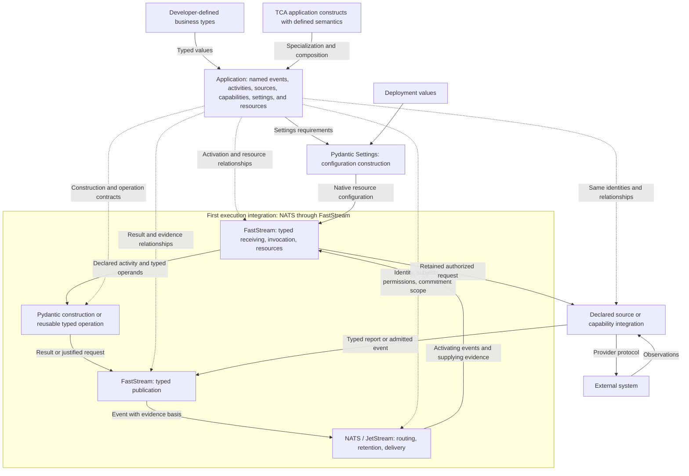

# TCA Architecture

**Owner:** Kyle Tobin  
**Status:** Architectural contract; public authoring specifications and native integrations must demonstrate the guarantees stated here. This document does not claim completed implementation.  
**Date:** October 31, 2026  
**Product:** [TCA Product Definition](../product.md)

**A TCA application composes business types and framework constructs with defined execution semantics into one model whose named relationships determine its event-driven execution through Pydantic, FastStream, and supported execution integrations.**

## 1. Purpose and quality goals

Developers build complete applications by naming, specializing, and composing supported types in a separate Python package that imports TCA. The constructs supply execution semantics; developers supply application-specific meaning and policy choices.

Framework authors use the same modeling discipline to define those constructs and their native realization. World and run identify modeling responsibilities within one framework, not separate programs or distributions.

A relationship has one authoritative declaration. Its native bindings and downstream projections derive from that declaration. The same names and relationships organize authoring, execution, and diagnostics.

Quality goals are correct construction and commitment, consistent composition, localized changes, durable continuation, and understandable event-driven behavior. Developers must be able to explain activation, prerequisites, results, and waiting from their declarations.

## 2. Architectural constraints

- Events drive transformational application activity. Pure value construction does not require application execution.
- Framework constructs define supported behavior through typed composition. Application authors specialize and compose them without handlers, registration scripts, or an imperative workflow encoded as configuration.
- The application model determines topology. Native configurations and bindings are derived artifacts, not independently maintained application definitions.
- Pydantic owns construction, FastStream supplies common receiving, invocation, publication, and lifecycle facilities, and the selected execution integration supplies native routing, retention, and delivery. Custom procedure fulfills only obligations their composition leaves unresolved.
- Application-authored validators, arbitrary computed-property bodies, serializers, default factories, custom constructors or schema hooks, callbacks, handlers, and workflow functions are forbidden. Reusable operations and adapters have explicit typed contracts.
- Framework and extension implementations must model their execution contracts. A typed interface over independently designed procedural orchestration does not meet this requirement.
- An allowed declaration cannot be rejected because an implementation recognizes a narrower syntax. Native Pydantic acceptance alone does not authorize forms outside TCA's contract.

## 3. Package structure and application boundary

TCA is one installable distribution, `type-construction`, with import namespace `type_construction`. Internal modules follow dependencies and responsibilities; separate distributions require independent use or release requirements.

| Path | Responsibility |
|---|---|
| `packages/python/type-construction/pyproject.toml` | Framework distribution metadata and dependencies. |
| `src/type_construction/__init__.py` within that package | Public exports, including `Model` and `Root`; no startup side effects. |
| `src/type_construction/models.py` | The two configuration-only value bases. |
| `src/type_construction/py.typed` | Typing marker. |
| `tests/` | Framework-specific contract and native integration tests. |

Execution-model and integration modules follow concrete contracts. This structure requires no empty `engine`, `core`, or plugin subsystem.

A developer's application is a separate installable Python package depending on `type-construction`. It owns its domain declarations, composes an `Application`, and exposes that runnable declaration through TCA's application contract. TCA supplies one reusable launch path for those declarations; application packages supply no startup orchestration or FastStream registration code.

| Participant | Responsibility |
|---|---|
| Application developer | Domain meaning, named application composition, and explicit identity, evidence, authority, and lifecycle choices not determined by the selected constructs. |
| Framework and extension author | Reusable construct semantics, supported composition, operations and integrations, and minimal native realization. |
| Deployment operator | Configuration values, credentials, infrastructure, and native permission grants. |
| External system | Its authoritative data, transactions, permissions, and effect guarantees. |

HTTP, CLI, direct calls, and message interfaces admit events and expose results through the same declared activity. They do not introduce another business execution path. Business value definitions remain independent of settings loading, messaging, and persistence.

## 4. Solution strategy: composition determines execution

A type defines a construct's contract. Its name and placement identify an application component. Specialization supplies business types, constraints, and policy choices; composition establishes relationships among components.

An `Event` records an establishment. An `Activity` connects an activating event to required inputs, a supported construction or operation, and its result event. Activation does not prove that all inputs are available or that external work is authorized. A result can supply evidence or activate further declared activity.

Composition determines connections wherever unambiguous. Otherwise, a typed relationship identifies the supplying occurrence or projection and its selection policy. Equal Python types do not choose suppliers. Relationships already established structurally require no second reference or registration.

Pydantic constructs values; FastStream invokes derived receiving and publishing bindings; the selected execution integration routes and retains events through its native facilities. Each binding identifies its source declaration, native guarantee, and remaining framework obligation. Neither application nor integration maintains another execution graph.

Application policies specify meaningful choices, including evidence selection, completion, and external recovery. Their enforcement follows the selected construct contracts. Applications do not describe retrieval loops, delivery tracking, commitment algorithms, or recovery algorithms.

## 5. Modeling contracts and building blocks

### 5.1 Value foundations and World modeling

`type_construction.Model` subclasses native `BaseModel`; `type_construction.Root[T]` subclasses native `RootModel[T]`. Both are defined in `models.py` and set `ConfigDict(validate_default=True, frozen=True)`. The bases contain only this configuration; they add no constructors, validators, traversal, serialization, or runtime behavior.

Business models, nested models, and framework-owned retained value contracts preserve those guarantees. The bases establish inherited native configuration; they do not prevent Python overrides or enforce the entire allowed authoring surface. Application acceptance must reject model or field settings that disable required guarantees and declarations containing forbidden application procedure.

| Form | Representation | Meaning established by construction |
|---|---|---|
| Scalar or refinement | Named configured `RootModel[T]` with native constraints | A business value satisfies its underlying type and constraints. |
| Product | Named configured `BaseModel` with business-typed fields | Required constituents exist together and satisfy their receiving annotations. |
| Sum | Explicit discriminated union of alternative models; optionally a named root | One declared alternative is constructed with its constituents. |
| Collection | Named root over a typed native collection | Members and structural constraints follow the declared native type. |
| Mapping | Named root over typed keys and values | A genuine keyed relationship satisfies its key and value contracts. |
| Finite vocabulary | `StrEnum` or literal values | A value belongs to the declared vocabulary. |

These forms compose recursively under native Pydantic construction rules. A named scalar remains a distinct business type; it is not interchangeable with its underlying annotation in positions where Pydantic requires a specific declaration, including discriminator fields. Named roots retain native JSON root shape. Untyped dictionaries and `Any` cannot replace business models.

The permitted surface includes native `Annotated` constraints, `Field`, concrete generic specialization, explicit discriminators, literal data defaults, aliases, nullability, and declared strictness. Native introspection exposes those declarations. TCA does not implement another type checker or a compatibility matrix for every native feature combination.

Successful construction establishes declared value guarantees, not undeclared cross-field rules, external truth, currentness, or permission to act. Those meanings require explicit models and relationships.

### 5.2 Application constructs and composition

TCA supplies the following specialized model contracts. Developers name, specialize, and compose them using the value foundations in section 5.1. Each construct provides its defined behavior; its application declaration supplies only the remaining application-specific meaning.

| Construct | Application declaration | Supplied contract |
|---|---|---|
| `Event` | A named kind of received information, requested work, decision, or result, with typed content and occurrence context. | Preserves content, identity, source, and retained establishment. A request establishes that work was requested, not that it completed. |
| `Activity` | An activating event, typed input requirements, a supported construction or operation, and a result event. | Invokes justified work, handles unavailable evidence, and retains results under the evidence and commitment rules. No application handler body. |
| `Application` | One composition of named events, activities, integrations, settings, and resources. | Uses shared native startup to realize the resources and bindings required by its composition; diagnostics identify those same declarations. |
| `Source` | An authoritative entry point for specified events through a supplied integration. | Applies the integration's receiving and source-admission contract under deployment-granted permissions. A declaration alone grants no authority. |
| `Capability` | A provider-specific interaction with typed requests and reports. | Specializes activity for external work: retained authorization, provider invocation, distinct report alternatives, and the provider's recovery contract. |
| `Settings` | Typed configuration requirements and permitted declarative defaults. | Uses native Pydantic Settings sources, precedence, parsing, defaults, and validation while preserving required model guarantees. No separate configuration loader. |
| `Resource` | An integration resource's settings, use, and explicit sharing where required. | Uses native resource creation, ownership, injection, and lifetime management. Live clients retain native types. |

`Settings` specializes native `pydantic_settings.BaseSettings` with `validate_default=True, frozen=True`. Developers specialize and compose configuration using native typed fields, `Field`, and `SettingsConfigDict`, preserving TCA’s required guarantees. Pydantic Settings supplies configuration composition and construction—including nesting, aliases, source acquisition, and precedence. An integration supplies the settings contract its resource requires; application composition reuses that contract. Source customization uses native extension points within framework or integration implementations. Business value bases remain independent of configuration sources.

A provider construct supplies the source, capability, settings, and resource relationships required by its contract. Developers do not redeclare what the construct or composition determines. A capability specialization does not require a second activity declaration describing the same work.

Reusable computations are named typed operations selected within compositions. Their supported operand and result contracts do not admit arbitrary application function bodies.

Additional meaning is expressed as typed relationships: identity and scope, shared supply or resources, evidence selection, membership and completion, authority, and lifecycle. These govern the particular placement or occurrence, not every use of a business class. Native field metadata can express field-level relationships without replacing application structure with a metadata interpreter.

Retained establishments, justification, and execution diagnostics are framework-owned typed facts using the same model discipline. Developers do not author bookkeeping declarations for them.

These constructs are authoring types. Their application placements establish native receiving, construction, and publication relationships; a named activity does not require a TCA-owned runtime service or runner. Concrete Python definitions must specify typed parameters, composition rules, inherited guarantees, and necessary application choices. Their native binding targets are specified in section 5.4; streams, subscriptions, durable consumers, and worker delivery groups derive from those relationships. No public `Queue` declaration is required.

### 5.3 Naming and identity are modeling contracts

The application model supplies a canonical declaration location for each component. Names identify declarations; they do not encode execution instructions. Runtime identity completes the location within its execution scope, including member keys where independently supplied membership requires them.

The naming contract must preserve the following distinctions in every native projection:

- The same type at two declaration locations represents two roles.
- Explicitly shared supply refers to the same occurrence; equal types or values do not establish sharing.
- Sum alternatives use declared discriminator values, not class names or annotation positions.
- Embedded collections and mappings remain parts of their containing value. Independent member addressing follows an explicit occurrence/membership relationship.
- Business identifiers describe what an occurrence concerns; they do not merge distinct occurrences or pursuits.

Business-subject correlation is a declared projection. Integration lookup derives from that projection without merging distinct occurrences or introducing a universal join.

Messaging topology follows independently addressed events and their declared source and activity relationships. Ordinary business fields and embedded members remain value structure unless an explicit event or membership relationship establishes independent addressing. Naming a business type or nesting a value does not itself require a subject, stream, or consumer.

Native addresses, including NATS subject names, derive from modeled identities through deterministic, unambiguous transport encoding. Business identifiers containing punctuation cannot inject separators or wildcards. Transport restrictions must not become arbitrary restrictions on World values.

Schema names, declaration locations, occurrence identities, and transport addresses are related representations, not interchangeable identifiers. Reference notation must identify modeled relationships without a separately maintained path or naming system. String paths and a general-purpose resolver are not assumed by this contract.

### 5.4 Native responsibilities

| Facility | Responsibility |
|---|---|
| Pydantic | Construction, constraints, introspection, schema, and serialization. |
| Pydantic Settings | External settings sources, precedence, parsing, defaults, and settings construction. |
| FastStream | Typed receiving, invocation, publishing integration, resource injection, acknowledgements, and process lifecycle. |
| Execution integration | Native routing, retained history, delivery/redelivery, permissions, schedules, and publication conditions that satisfy the selected construct contracts. NATS/JetStream is the first implementation. |
| TCA framework | Composable application constructs, typed execution facts, and minimal native bindings preserving their contracts. |

Core constructs express application meaning; supplied execution integrations realize it through native facilities. Application resource relationships select the integration through typed composition and ordinary imports, without a second backend-selection setting. FastStream's common facilities are reused rather than wrapped in a competing broker or execution system.

Each integration supplies typed configuration, resource specializations, and the necessary native bindings. Provider dependencies and exports belong within that integration boundary; core contracts do not require provider-specific fields or client types. This boundary does not require separate distributions, dynamic discovery, a plugin registry, or a TCA execution manager.

NATS/JetStream is the first concrete execution integration. The remainder of this section specifies its realization; these native mechanisms do not define universal representations for other integrations. TCA derives the application-specific parameters of these facilities:

| Declared relationship | Native realization |
|---|---|
| Configuration and resource use | Pydantic Settings constructs configuration; native `NatsBroker` objects and FastStream/integration lifecycles establish connections, injection, and cleanup. |
| Event receipt and source admission | `NatsBroker.subscriber(...)` registers a framework-owned typed receiving function on the derived subject. TCA applies the declared admission contract while preserving source and occurrence context. |
| Activity activation, construction, and result | FastStream invokes a framework-owned binding function that connects typed receiving to native Pydantic construction or a supported typed operation, then to `NatsBroker.publisher(...)` or native broker publication. |
| Retention and delivery | FastStream's `JStream` and native nats-py `ConsumerConfig` describe the required stream coverage, consumer delivery, and acknowledgement behavior. |
| Authority and commitment | Derived native permission configuration and publication conditions enforce the modeled boundaries under operator-granted permissions and section 8's guarantees. |

Framework startup uses ordinary procedural calls to construct native objects, register derived bindings, and invoke native lifecycle management. Binding functions implement the necessary connection between these facilities. Developers author no FastStream handlers, decorators, registration functions, or boot callbacks. Framework code preserves modeled meaning without maintaining an independent execution program.

Subjects are native message addresses used in publications, subscriptions, and stream filters; they need no separate creation service. Streams and consumers are native resources. Their definitions derive from the model; native facilities create them or connect to operator-provisioned resources under deployment permissions. Existing retained work remains governed by section 8.5.

The default activity binding is a named durable pull consumer, configured through FastStream's `PullSub` and native nats-py `ConsumerConfig`. Replicas of the same application share the logical stream and consumer identities for each activity; distinct activities retain independent delivery relationships. Changing worker count or replacing a worker does not change declaration or business occurrence identity. Workers bind to the same durable consumer so startup and replacement preserve delivery progress. Live resource clients are not serialized into events.

Retained typed events are the authoritative execution history. Authoritative history uses file-backed JetStream streams with native `LimitsPolicy`, preserving evidence independently of delivery acknowledgement under section 8.3's retention and commitment guarantees. State and progress views derive from that history; TCA adds no event-store service or separate authoritative execution state.

Every integration preserves access to its actual native objects for framework and extension implementations, without a TCA client facade. In the NATS integration, these are `NatsBroker`, nats-py `Client`, and `JetStreamContext`. Supported native injection facilities, including FastStream’s `Client` and `JsClient` annotations in their supported contexts, expose those objects. FastStream’s convenience methods do not limit the NATS capabilities available to a construct’s implementation. Native operations remain governed by that construct’s declared relationships and guarantees; application authors continue to specialize and compose models.

TCA does not reimplement native delivery, invocation, event retention, scheduling, settings loading, or value construction. Integration modules isolate provider dependencies and bindings while reusing FastStream's common abstractions.

### 5.5 Extensions and runtime foundation

An extension contributes reusable model types and their required native realization. A provider integration defines its source or capability specialization, request/report/settings models, resource relationships, effect guarantees, recovery contract, and protocol adapter. Applications import and compose those types through ordinary Python imports; consuming an integration requires no application-authored adapter or workflow.

Extensions use the application's existing identity and relationship contracts. They do not introduce their own workflow language, naming authority, separately configured application graph, or hidden business decisions. An independently useful extension may be distributed as a separate Python package. Extensibility does not require a plugin registry, dynamic discovery service, callback system, or additional execution infrastructure.

An execution integration supplies the native realization of shared application contracts. Another provider is supported only with evidence that its bindings fulfill the required construction, admission, durable evidence, commitment, recovery, security, and ownership guarantees. Similar feature names or FastStream API compatibility alone do not establish those guarantees. Integration selection does not change business meaning or weaken a construct's contract; native capabilities remain available without promising identical operational behavior across providers.

## 6. Runtime views

### 6.1 A configured application becomes available

The shared launch path reads the exposed `Application` declaration and constructs its required configuration through Pydantic Settings. Invalid required configuration prevents dependent resource startup and identifies the setting. Valid configuration does not establish connectivity or authorization.

Startup consumes the selected integration's resource bindings through FastStream's common lifecycle facilities and registers the receiving, invocation, and publishing bindings determined by the declaration. FastStream and integration lifecycles establish and release native connections and resources. Shared framework startup ensures that acquired resources undergo their native release operations after partial initialization failure and during shutdown, using ordinary acquisition/release bracketing where necessary. Cleanup preserves the initialization failure for diagnosis.

A minimally configured application with no domain events or activities can connect through its selected execution integration and enter the native application lifecycle. It creates no domain subscriptions, consumers, or streams. The modeling types are available through ordinary imports; adding domain declarations determines which native bindings and resources startup realizes.

Startup enables event processing; it does not itself pursue business outcomes. The same launch path handles applications with different declarations without application-specific startup branches.

### 6.2 An event activates an activity and establishes a result

The selected execution integration delivers an event through the derived native FastStream subscription. Native Pydantic receiving constructs the declared content while the binding preserves occurrence and source context. External events undergo the selected source's admission contract. FastStream invokes the framework-owned binding for the declared activity; application developers supply no receiving or processing function.

The activity contract identifies activation, typed operands, and result. A request or demand activates work through an event. An activating event can supply inputs directly; additional evidence follows declared supply and selection relationships.

When the required evidence and authority are established, Pydantic constructs the composition or a supported operation consumes typed operands and constructs its result. Internal assembly preserves receiving aliases without serializing and reloading constituents.

The result is published under its declared identity, evidence basis, and commitment conditions. It can supply or activate subsequent activity. Acknowledgement follows the retained processing result, not merely successful receipt.

### 6.3 Evidence arrives over time

An activity without required evidence remains unestablished. Its declared relationships and retained operands express availability; no half-constructed object or pending table duplicates that information.

A relevant subsequent event permits another attempt through the same derived bindings. Native consumers and retained history preserve discoverability across interruption. A retry recognizes an existing establishment from retained identity and basis instead of creating another authorization.

### 6.4 A capability invokes an external provider

The capability contract applies declared demand, prerequisites, source authority, and lifecycle. Its authorized request is retained before the provider adapter consumes it.

The adapter implements the provider protocol without changing business content or introducing a business decision. Observations use the declared receiving contract and produce typed report events. A report can establish content even when attribution to a particular attempt is unresolved.

Provider acceptance, business completion, and transport acknowledgement remain separate facts. Redelivery does not authorize another external effect; recovery follows the capability's provider contract.

## 7. Deployment and configuration

The application package declares typed settings requirements. Deployment supplies environment-specific values and credentials through native Pydantic Settings sources. A supported enterprise configuration integration can replace ENV without changing the receiving schema or business meaning.

Among enabled native sources, precedence is explicit initialization values, ENV, configured dotenv, configured secret files, then defaults. The launch contract introduces no hidden overrides or implicit CLI settings parsing. Configuration source adapters belong to framework or integration implementations.

Settings remain fixed for a process lifetime unless an explicit modeled change contract exists. Restart constructs new settings. Operational endpoints and credentials configure resources; settings affecting business meaning participate in construction and retained justification. Secrets are not retained as business evidence.

An integration determines its resource configuration, owner, use, and lifetime. Applications specify sharing only where composition does not determine it. Native lifecycle management releases resources after initialization failure and during shutdown. Client recreation does not authorize replaying an external effect.

Resource ownership is scoped to an application runtime. Uses of the same declared resource within that runtime share its native instance; equal types or configuration values do not establish sharing. Separate runtimes own separate native clients. Replicas of the same logical application preserve the logical topology identities derived from its declarations, including stream and consumer identities in NATS. Where composition or the native broker context determines the resource association, applications declare no additional reference.

Application relationships determine logical addresses, delivery relationships, retained history, and commitment scope. For NATS, these project to subjects, stream coverage, and durable consumer identity. Deployment supplies native replication and placement settings through `JStream` and `ConsumerConfig`; consumer state inherits stream replication by default. Native creation and binding preserve configured retention and replication and existing consumer progress. NATS/JetStream owns clustering, replication, and leader election.

Execution integrations require verified encryption, authenticated application identity, and deployment-granted least-privilege permissions. Native security facilities enforce these guarantees; application credentials confer no provisioning authority unless explicitly granted. Configuration models hold deployment references to secrets and trust material, not credential contents in ordinary values or URLs. No plaintext fallback or certificate-verification bypass is exposed.

The initial NATS identity contract uses verified TLS and native JWT/NKey credentials loaded from a deployment-supplied `.creds` file. Both secure TCP/TLS and WSS are supported. TCP requires native TLS-first with matching server configuration, so authentication cannot precede encryption. Mutual TLS is not mandatory in addition to JWT/NKey authentication. Native SSL, FastStream, and NATS perform verification and enforcement; TCA supplies only the required modeled configuration and bindings.

Development uses an application container and a secured JetStream-enabled NATS container with persistent storage. Development and tests follow the same security contract using generated credentials and certificates; private material is not committed or baked into images. Secret mounts and persistent data require restricted access, with secret mounts read-only where applicable. Derived resources and deployment-granted permissions must preserve the execution guarantees. Deployment layout or a subject prefix alone does not establish atomic commitment coverage.

## 8. Guarantees attached to modeled relationships

Construct definitions supply these guarantees. Application policy choices specialize their meaning; native bindings enforce them without an application-authored enforcement procedure.

### 8.1 Values and derivations

Established values are immutable facts. Native freezing prevents reassignment but not mutation inside containers. Use tuples, frozensets, and frozen nested values where appropriate; supported mappings remain unmutated. A replacement undergoes native construction. Unchecked copy updates and bypass construction cannot establish validity.

World operations have typed operands, an explicit producer, and typed result/alternative contracts. Product construction does not implicitly perform arithmetic. Shared framework implementations may use native properties, cached properties, computed fields, or declared construction-time derivations. An annotation or `computed_field` does not validate its result.

Pure derivations use declared operands, not ambient clocks, randomness, or external reads. Cached views remain valid only while their operands are unchanged. Views and caches do not establish events. A result needed as evidence is constructed and retained separately with its basis.

Durable and external receipt use native construction from the actual representation. Persisted events use native JSON serialization and receiving construction, without a custom codec. Internal composition consumes established typed constituents directly. Authoritative dumps use native `exclude_computed_fields=True` to exclude presentation fields while retaining ordinary result fields. Receiving a retained result does not rerun its producer.

### 8.2 Supply, selection, and completion

Supply identifies both the evidence relationship and its version-selection meaning. A decision occurrence adds source and replacement policy to a sum value. Latest, first, and history-sensitive policies are explicit; there is no implicit latest-wins rule.

With Approved@1, Declined@2, Approved@3, latest selects @3 and first selects @1. The minimum of latest-per-alternative results is not the first event. Currentness is selected across eligible candidates for the occurrence, not independently at one alternative subject. Unrelated descendants and failure records are not automatically candidates.

Member completion uses declared evidence. A container's native validity does not prove all independently supplied members have arrived. Silence does not establish completion. A count establishes completion only under a declared membership rule; time-based stopping uses the declared native deadline relationship.

Requiredness, nullability, defaults, acquisition, and stopping retain distinct meanings. A default permits omission, not acquisition. Null is a permitted value, not a decision to stop waiting.

| Condition | Interpretation |
|---|---|
| Required evidence absent at retrieval | Unavailable dependency. |
| Supplied payload fails receiving construction | Invalid supplied information. |
| Available operands fail consumer construction | Consumer failure attributed to those versions. |
| Decision produces a non-holding alternative | Valid business evidence. |
| Provider reports operational failure | Capability report governed by its recovery contract. |

### 8.3 Establishment, justification, and concurrency

The execution integration retains facts needed for continuation and explanation independently of acknowledgement. A published composition retains its content and basis even when it only assembled values. Temporary objects do not require events.

Declared supply and retained justification are the same relationship before and after execution. The retained basis records the consumer operand, supplying occurrence, integration-specific retained evidence identity, and any projection actually consumed. NATS represents retained evidence identity using stream and sequence; those fields are not a universal event representation. Headers may assist routing but are not the sole authority for justification.

A changed value is a new establishment. For replaceable or evolving evidence, publication must protect the basis against every change that could invalidate it, including authority/lifecycle changes and arrivals affecting omission or membership.

The integration must enforce commitment against changes across the complete declared scope using demonstrated native facilities. The following is the NATS realization, not a universal transport algorithm.

Use a covering subject filter within one stream, including the publication destination. Capture stream boundary `S` before reading; retrieve policy-selected evidence and the scope watermark `W` as of that same boundary. Publish with `Nats-Expected-Last-Subject-Sequence: W` and `Nats-Expected-Last-Subject-Sequence-Subject` set to the covering filter. A stream-wide scope uses `Nats-Expected-Last-Sequence: S`. A conflict requires refreshed evidence and reconsideration.

Nesting alone does not establish coverage: suppliers outside a subtree can invalidate its consumer. A wider scope can cause false conflicts but must not admit stale work. Evidence from another stream requires explicit retained admission into the commitment scope; this does not create an upstream transaction.

Reads must establish sufficient freshness and complete their bounded retrieval, including pagination. Related publications requiring all-or-nothing establishment use a demonstrated atomic native facility. No transaction is assumed across arbitrary streams or external systems. Retention, expiry, and deletion must not conceal changes relevant to a commitment.

### 8.4 Authority, lifecycle, and time

Source relationships derive native publication permissions. Receiving construction establishes content; source admission establishes whose evidence it is; capability authorization establishes permitted work. These guarantees do not substitute for each other.

Alternative publication addresses derive from the constructed discriminator. External ingress must preserve the declared relationship between addressed context and received content. Native permissions alone do not prove payload/address agreement.

Cancellation stops new authorization while preserving initiated work and later observations. Completion, finality, reopening, and provider repeat safety follow their declared contracts. Waiting and lifecycle apply to ordinary constructions as well as capabilities.

Runtime-relative deadlines use the selected integration's authoritative recording time and native notification facilities; the NATS realization uses NATS recording time and native scheduled notifications. Restart does not reset deadlines; late delivery does not redefine them. External timestamps remain business claims.

### 8.5 Evolution and explanations

Retained work identifies the declarations, required configuration, operation contracts, and executable dependencies that established its meaning. Derived identity detects change; it does not alone establish incompatibility. Schema equality does not establish executable equivalence.

New deployments cannot silently reinterpret established work. A renamed declaration is not automatically the same occurrence merely because its value schema is unchanged. Every affected native projection must preserve the declared identity/compatibility decision.

Authoring diagnostics and runtime explanations identify the same named application components and relationships. Retained facts explain triggering events, consumed evidence, authority, results, failures, and legitimate next progress. Native transport details remain traceable to those declarations.

## 9. Consequential decisions

| Decision | Architectural consequence |
|---|---|
| One modeling discipline for framework and applications | Framework constructs define execution semantics through typed composition and native facilities. |
| Named event-driven application constructs | Developers understand and compose events and activities; they do not supply handlers or configuration-level execution algorithms. |
| One authoritative topology and vocabulary | Identity and relationships determine native bindings and organize both authoring and runtime explanations. |
| Retained events justify work and continuation | Execution preserves declared demand, evidence, authority, and external effect boundaries. |
| A developer-owned application package | Developers own application meaning and policy choices; supplied constructs own their execution guarantees. |
| One framework distribution | `type-construction` exports value foundations and application constructs; internal modules preserve dependency boundaries. |
| Execution integrations through typed composition | FastStream's common facilities and integration-specific native bindings realize shared contracts. NATS/JetStream is the first implementation; provider representations remain within its boundary. |
| Shared native startup | One launch path configures native facilities and bindings, supports an empty application, and uses native lifecycle management. |
| Extensions through typed composition and imports | Reusable operations and provider integrations require no plugin discovery or separate workflow language. |

## 10. Quality scenarios

| Scenario | Required observable result |
|---|---|
| Start an empty application with valid configuration | The shared launch path connects through the selected integration without domain activity or speculative domain messaging resources; NATS is the initial verification target. |
| Run a declared event-to-result relationship with ENV configuration | The same launch path establishes native receiving, Pydantic construction, and retained publication without application handlers, boot callbacks, or duplicate wiring. |
| Run differently composed applications | Their declarations determine native bindings through the same startup implementation, without application-specific startup branches. |
| Invalid required settings | Construction fails before dependent resources or activity begin, identifying the setting. |
| Read an application declaration | A developer explains activating events, input requirements, possible results, and waiting using its declared names and relationships. |
| Compose supported value and application types | Contracts survive nesting, named roots, alternatives, repeated placements, and explicit sharing. |
| Change an event or activity relationship | All affected native bindings, including subscriptions, publication targets, stream/consumer configuration, permissions, and diagnostics, follow the authoritative declaration without another wiring edit; retained work preserves its declared meaning. |
| Add an ordinary nested business field | Native value construction reflects the field; messaging topology gains no address or resource unless an explicit event or membership relationship requires it. |
| Inspect execution and native topology | Events, activity attempts, subject addresses, subscriptions, publication targets, stream filters, consumer configuration, and permissions trace to the same declarations and occurrence identities. |
| Compose a supplied provider integration | Its source, capability, settings, and resource contracts compose without an application-authored adapter or workflow. |
| Compose a supported execution integration | Its resource relationships select native bindings without a second backend setting; provider-specific configuration and retained evidence identities preserve the shared guarantees. |
| Connect to secured infrastructure | Trusted, authenticated connections and authorized operations succeed; invalid trust, identity, and forbidden operations fail without plaintext fallback or prohibited effects. |
| Add a native system projection | It preserves modeled identities and relationships without creating another application definition. |
| Missing, malformed, or negative evidence | Waiting, receiving failure, consumer failure, and valid negative alternatives remain distinguishable. |
| Race evidence changes against publication | Stale establishment is rejected; legitimate work succeeds after refresh. |
| Interrupt after publication before acknowledgement | Retained progress is recognized without duplicate authorization. |
| Replace a process or configuration source | Native resources are recreated while retained business meaning and execution relationships remain intact. |
| Scale workers and fail over a NATS broker | Unchanged declarations run across multiple workers against replicated JetStream. After a worker stops and a broker leader fails while quorum remains, surviving or replacement workers continue through the same durable consumers and retained facts, preserving occurrence identity and commitment conditions; input acknowledgement still follows retained result publication. |

Acceptance uses public declarations and real native integrations. Handwritten test coordinators or configuration encoding an execution algorithm do not demonstrate the authoring contract. Tests establish TCA-specific relationships and integration behavior rather than reproduce native framework test suites.

## 11. Unresolved specifications and verification limits

Remaining authoring specifications define concrete Python specialization/composition syntax, necessary declaration references and address encoding, and the notation for exposing and selecting an application declaration at launch. These choices must preserve the established relationships and native binding targets. They do not reopen ownership of execution or require a separate execution system.

Model-only authoring, supplied construct semantics, one authoritative topology, shared native startup, empty-application behavior, native binding targets, topology granularity, native settings, unified packaging, and import-based extensions are settled. Derive remaining choices from application meaning and native capabilities; missing details cannot justify implementation-specific restrictions or speculative machinery.

Each execution integration must demonstrate the shared guarantees against its native semantics. Replica freshness, retrieval pagination, atomic publication, and external recovery require evidence against the selected versions and deployment configuration. Source inspection, isolated experiments, and single-node runs establish only their demonstrated scope.

Implementation evidence and delivery planning belong in separate artifacts.

## 12. Glossary

| Term | Meaning |
|---|---|
| Value type | A business value contract expressed using the permitted native modeling forms. |
| World operation | A reusable computation with typed operands and constructed results. |
| Application construct | A framework model with defined execution semantics, specialized and composed by developers. |
| Application | The runnable composition of business types and application constructs. |
| Event | A typed establishment that information was received, work was requested, or a result was produced. |
| Activity | A declared reaction connecting activation, input requirements, supported work, and result events. |
| Source | An authoritative event entry point governed by receiving and admission contracts. |
| Capability | An external interaction with typed requests/reports and provider-specific effect and recovery guarantees. |
| Settings | Typed configuration constructed from native Pydantic Settings sources. |
| Resource | A declared integration resource requirement with native ownership and lifetime. |
| Declaration location | A named placement in the application; distinct from its reusable type and runtime occurrences. |
| Occurrence | A realization of a declaration within its execution and identity scope. |
| Evidence | An admitted retained fact with provenance and version. |
| Establishment | A constructed result committed under its identity and evidence basis. |
| Declared topology | The names, placements, identities, and relationships expressed by application composition. |
| Execution integration | Supplied typed configuration, resource specializations, and native bindings realizing the shared execution guarantees through a selected provider. |
| Native binding or projection | A system-specific realization derived from those declarations. |
| Subject | A native NATS message address derived from modeled identity and used in publication, subscription, and stream filters. |
| Stream | A native JetStream resource retaining messages under its configured subject coverage and retention policy. |
| Consumer | A native JetStream resource maintaining delivery and acknowledgement state for its subscription. |
| Framework | The `type-construction` distribution containing value bases, application constructs, and native integration. |
| Extension | Reusable types and required native implementation imported and composed within an application. |
