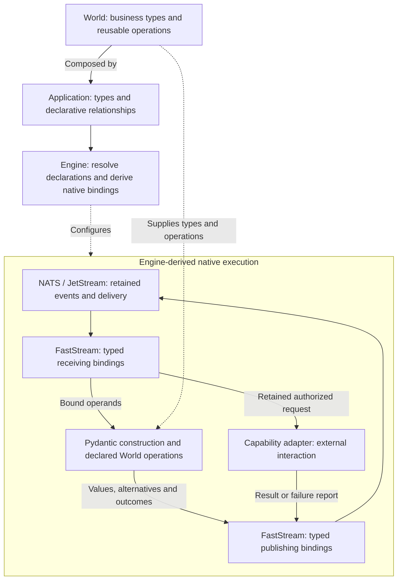

# TCA Architecture Design

**Owner:** Kyle Tobin  
**Status:** Approved architectural direction; concrete bindings require demonstrated integration.  
**Date:** October 30, 2026  
**Product:** [TCA Product Definition](../product.md)

## 1. Typed namespace and native execution

TCA realizes a model-only business program as a typed, event-sourced NATS namespace. World supplies business types and reusable operations. Application declarations identify their occurrences, supplying relationships, sources, capabilities, and outcomes. Engine derives the native addressing, permissions, receiving and publishing bindings, consumers, and schedules that execute those declarations.

These bindings are the runtime realization of the graph. Developers author business types and relationships once; they do not maintain a separate workflow or transport program. Engine reads those declarations and derives their bindings, not their business meaning.

The namespace carries addressed business events and native messaging guarantees. World constructions and explicit relationships establish the business semantics those addresses connect.

## 2. Model-only authoring and World semantics

Application authors declare Pydantic models, constrained fields, literals, discriminated unions, nested compositions, collections, literal defaults, and explicit relationships. Sources, supplying references, conditional acquisition, capability prerequisites, completion, and outcomes are modeled relationships.

Application-authored validators, computed-property bodies, serializers, default-factory functions, callbacks, handlers, and workflow functions are forbidden. Framework configuration is derived from the model and declared deployment requirements.

World provides reusable typed values and operations for arithmetic, quantities, comparisons, Boolean composition, selection, projection, collections, and completion. Operations have explicit operand and result types. A computation produces a separately identified result; receiving or decoding that result does not rerun its calculation.

Pydantic constructs the declared values and checks their constraints and alternatives. Framework value implementations own their native invariant mechanisms. Consumers require the appropriate constructed prerequisite or decision alternative. Non-holding decisions, invalid information, missing evidence, and operational failure remain distinguishable.

World has no messaging or persistence dependency. Framework and extension authors implement reusable operations and external adapters through defined contracts. Extensions add reusable semantics or integrations; they do not hide application workflows or business decisions in validation hooks.

The public authoring contract presents World compositions and Engine-owned execution relationships coherently. Native field semantics and repetitive wiring are derived. Developers supply only meaning that cannot be inferred, change a business rule in its declaration, and receive diagnostics in application vocabulary.

## 3. Binding the graph to native facilities

An occurrence is a realization within a pursuit, identified by its declaration location and, where applicable, its declared member key. Business identifiers describe what it concerns. Equal values, matching types, names, or business identifiers do not merge occurrences. Sharing follows an explicit supplying reference or an unambiguous structural relationship; ambiguity fails binding.

Engine resolves references to typed operands or declared projections. Static inconsistencies fail loading. Declared identity variables complete subject-dependent addresses when their values become available. Resolved identity determines addressing; assigning a shared address cannot invent a supplying relationship.

| Declared meaning | Native realization and remaining responsibility |
|---|---|
| Occurrence identity | Derive an address or address pattern from the resolved occurrence and identity values. Preserve distinct occurrences and explicitly shared suppliers. |
| Supplying relationship | Bind the supplier's addressed events to the consumer's named, typed operand. Native addressing selects the receiving relationship; no generic payload matcher rediscovers it. |
| Decision alternative | Publish a typed result. Use alternative-specific publication/subscription bindings where they directly realize the declared branch; require agreement between the discriminator and address. |
| Source authority | Enforce publication permissions for the declared source channel and consume its established identity directly. Payload validity and external execution authority retain their separate contracts. |
| Demand | Activate derived dependency and acquisition bindings for the pursued outcome and selected alternatives. General evidence reception remains available independently; receipt alone does not activate acquisition. |
| Collection membership | Derive keyed member addresses and native subscription patterns. Equal-valued members under different identities remain distinct. |
| Collection completion | A World construction consumes declared membership and completion evidence. Members can support independent work before the complete collection is established. |
| Business events and progress | JetStream retains events; native consumers provide delivery, distribution, acknowledgement, and redelivery. Do not duplicate that progress bookkeeping. |
| Deadlines | Bind declared anchors to NATS recording timestamps and native scheduled notifications. |
| Commitment | Use native conditional or atomic publication over the authoritative conflict scope, covering changes relevant to the justification. |

An accepted intent activates its declared outcome. Required dependencies are pursued through their suppliers; conditional dependencies follow their declared alternatives. Native requiredness, nullability, and defaults retain their construction meanings. A default permits omission, not acquisition. Optional acquisition that waits has an explicit stopping relationship. Changing demand stops newly justified acquisition on the abandoned path while preserving initiated work and later observations.

Completion follows the declared relationship, not silence or an invented timeout. Message count establishes completion only when a declared membership rule makes that count meaningful.

Generated FastStream subscribers and publishers use the declared receiving and publishing types. FastStream supplies native parsing, Pydantic integration, dependency injection, lifecycle, and acknowledgement facilities. Native NATS access supplements capabilities not exposed through FastStream within the same lifecycle. Bindings preserve intended fan-out and distributed-work semantics.

An external integration that supplies only a business key may need additional correlation. Resolve that integration's specific gap using native addressing, retention, and lookup; do not send all addressed interactions through a universal join mechanism.

These allocations do not prescribe one consumer per member, a universal selection strategy, or a fixed stream layout. Concrete configuration follows the declaration's required behavior.

## 4. Event data contract

Accepted intent, evidence, operation results, authorized requests, lifecycle decisions, and outcomes are retained as typed business events. JetStream is the authoritative execution history. Derived views and caches are reconstructible from that history and establish no competing authority.

Event payloads use Pydantic's native JSON serialization and receiving validation through FastStream. JetStream retains and delivers the published bytes. Framework-provided message and value types own compatibility with their declared serialization/receiving path, including preservation of business fields and union alternatives.

Operation inputs and produced results have distinct contracts. Decoding a retained result constructs that result; it does not rerun its producer calculation. Receiving boundaries establish declared relationships between addressed context and payload identifiers.

Persistence concerns declared business data, not arbitrary Python instances or application procedures. No pickling subsystem, universal instance-restoration algorithm, or application-authored codec is required.

Direct-call, CLI, HTTP, and event interfaces reuse the same business declarations. Representation differences introduce no competing business rules. Applications may integrate external business-data stores; those stores retain their own constraints, permissions, and transactions.

## 5. Commitment and continuation

A capability declares its prerequisite/request type, report alternatives, source relationship, and actual provider recovery guarantees. Constructed business prerequisites, declared demand, bound provenance, lifecycle, and provider authority justify work together. Constructibility alone grants no external permission.

Retain the authorized request before invocation. The adapter receives that request through its declared data contract and translates it into the provider protocol without silently changing its business content or adding another business decision.

Authorization and conclusion identify the evidence versions they consumed. All changes authoritative for that justification participate in its concurrency boundary. Native conditional and atomic publication protect the selected scope; destination-only checks cannot establish consistency with changing supporting evidence. No transaction is implied across arbitrary streams or external resources.

Acknowledgement follows the retained processing result. Native consumers keep work discoverable across interruption. Repeated coordination does not create another authorization for the same established attempt. Delivery, provider acceptance, business completion, and transport acknowledgement remain different facts.

Native redelivery does not grant permission to repeat an external effect. Capability contracts govern idempotent, safely repeatable, reconcilable, and intervention-required execution. Immediate and delayed reports satisfy the same declared business relationship. A report may establish content while its attribution to an attempt remains unresolved.

Source declarations determine replacement and dispute behavior; there is no undeclared latest-wins policy. New evidence changes current knowledge without rewriting historical justification. Outcomes declare completion and finality; reopening requires declared policy. Cancellation stops new authorization, with dispatch ordering preserving initiated work and provider guarantees. Intervention supplies authoritative evidence, not an invented repeat-safety guarantee.

NATS owns runtime time. Server recording timestamps anchor runtime-relative deadlines; stream sequence establishes retained order within its stream scope. Native schedules deliver declared deadline notifications. Restart does not reset deadlines, and late delivery does not redefine them. External timestamps remain typed business claims; evaluator wall clocks do not determine progression.

Retained work identifies the model and operation versions that established its meaning. New deployments cannot silently reinterpret incompatible work. Continuation uses retained events and native consumers without a live request or coroutine, arbitrary object restoration, or automatic replay of external effects.

## 6. Engine implementation boundary

Engine owns the following code:

1. Read declarations and resolve their typed relationships.
2. Generate and activate native bindings and configuration.
3. Supply named operands to Pydantic constructions and reusable World operations.
4. Publish their typed results and justified capability requests.
5. Apply declared lifecycle and provider contracts where native delivery alone cannot establish the required fact.

Engine consumes business guarantees from World and enforced bindings. It maintains no second runtime account of a relationship already faithfully represented by those bindings. Additional retained records or coordination require a specific unmet obligation; a semantic distinction alone does not prescribe a subsystem.

No separate business-validation language, router, trust engine, event-store service, scheduler, deadline scanner, delivery-progress tracker, redelivery engine, or worker distributor belongs in Engine.

Development uses one application dev container and one JetStream-enabled NATS container with persistent storage. This is a single-node development topology, not a high-availability claim.

## 7. Design evidence and acceptance

For every consequential relationship, demonstrate:

**Declaration → address and permission → receiving binding → constructed operand/result → downstream binding → retained outcome or capability request.**

Name the actual native mechanism and guarantee at each step. For each remaining Engine operation, identify the exact fact the native composition leaves unestablished. Demonstrate the public authoring contract, concrete native mapping, and integrated behavioral histories using the same types, identities, and bindings.

Acceptance requires a model-only application progressing from intent through events, constructed prerequisites, external work, interruption, and outcome. Demonstrate independent work, conditional demand, shared dependencies, distinct collection members, completion, early and delayed evidence, cancellation, and provider-governed recovery. Test prevented errors alongside legitimate progress.

Show a business-rule change made once and diagnostics explaining established facts, attempted work, blocked dependencies, and legitimate next progress in application vocabulary.

Use focused checks against selected native versions. Distinguish executed integration, isolated experiments, derived behavior, and unresolved claims. Subject grammar, stream/consumer configuration, and commitment scope require concrete demonstration; native feature names alone do not establish the composed guarantee.

The governing acceptance rule is a complete model-only business program, faithfully realized through native facilities, with no application workflow code and no duplicated native subsystem.
